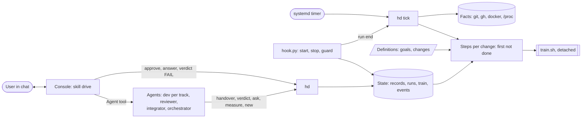
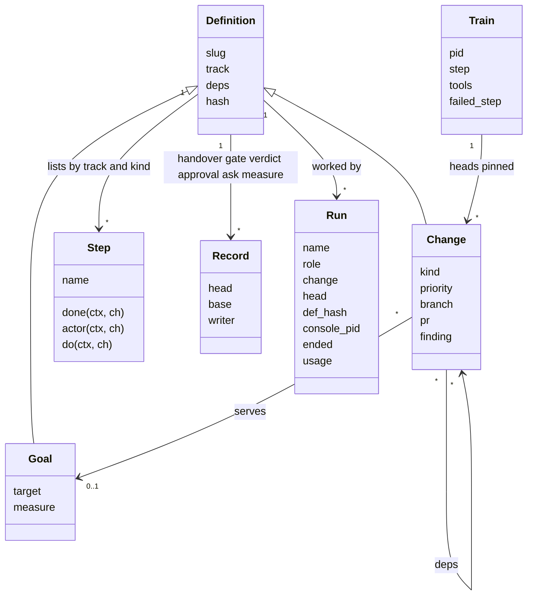
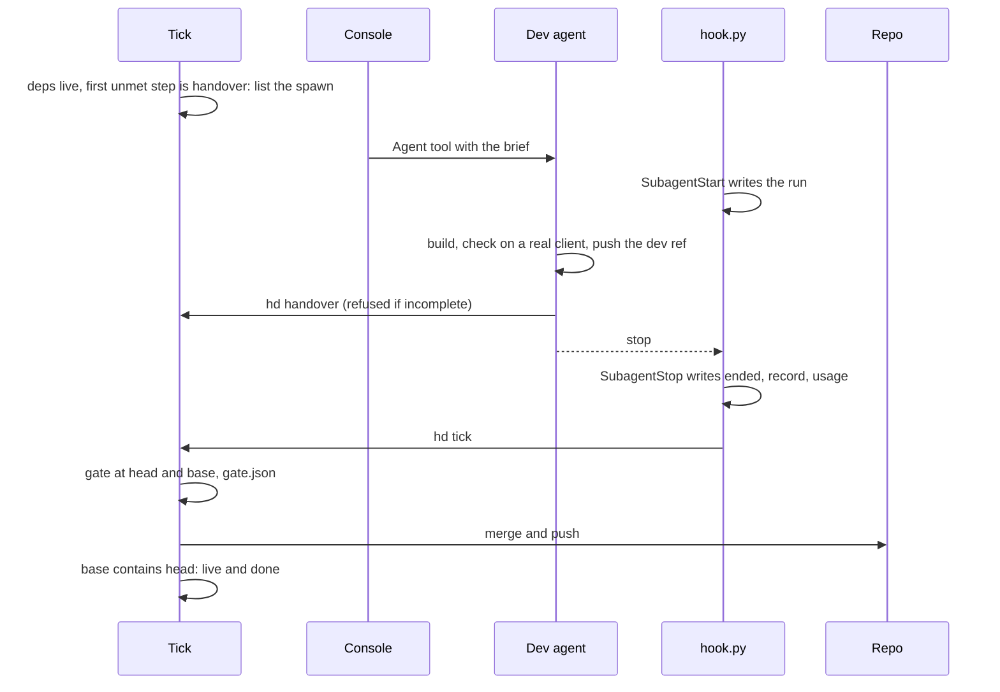
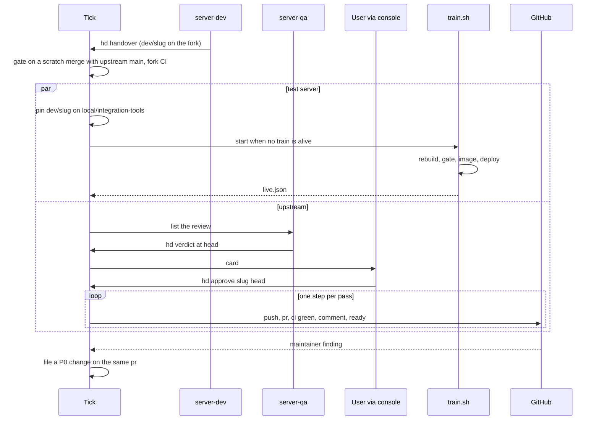
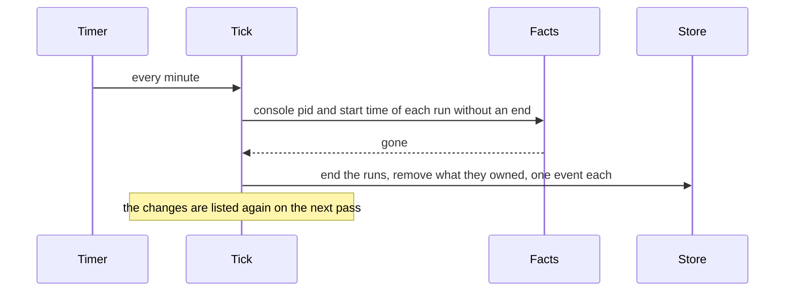

# Architecture of the harness (hd)

The solution to docs/PROBLEM.md that meets docs/PRD.md (R1–R7). Each module's docstring is its spec; this file is the map.

## 1. One mechanism

A **change is a list of steps**. A step is a predicate over facts ("done when") and an action by one of three actors: a
**script** (the pass runs it), an **agent** (the console spawns it), or the **user** (a card in chat). `hd tick` is one
short pass, run by a systemd user timer every minute and after every agent run: it reads the facts, and for every change
whose dependencies are live it does the first step that is not done. Stages, dispatch, cards, alerts and goal progress
are all read off the same step lists; nothing of the kind is stored. Repairs are steps of the harness itself, run first.



| Module | Responsibility |
|---|---|
| `hd.py`, `hd/cli.py` | nine commands: console `hd`, `approve`, `answer`; agents `handover`, `verdict`, `ask`, `measure`; people and the orchestrator `new`; timer and hook `tick` |
| `hd/store.py` | definitions, records, runs, events, the one `flock` on the state dir |
| `hd/facts.py` | refs and containment (fetching each remote once per pass), `gh` PR state, checks and comments, fork CI runs, releases, containers, images, pids with start time |
| `hd/steps.py` | the step lists per track and kind, dispatch, questions, cards, briefs; pure over `Ctx` apart from the script actions |
| `hd/server.py` | the server track's own code: pins on the tools branch, starting the train, filing maintainer findings |
| `hd/tick.py` | one pass: repairs, then the first unmet script step of each ready change, then findings; alerts |
| `gates/client.py`, `gates/server.py`, `gates/harness.py` | the script gate of each track: `<slug> <head> <base> <evidence>`, exit 0 ok, 1 fail, 2 pending |
| `hooks/hook.py` (+ `shellparse.py`) | one program, three events (section 6) |
| `train/train.sh`, `image.sh`, `deploy.sh`, `Dockerfile.integration` | the one long process (section 7) |
| `hd.yaml` | repos, paths, the tracks (dev ref, base, remote), the roles (push refs, record owed, worktree), the agent count |
| `.claude/agents/*`, `.claude/skills/*` | role files and skills; `drive` is the console loop |

## 2. Data

**Definitions** (committed under `harness/`, written by people, the orchestrator and, for findings, the pass):
```yaml
# goals/client-api.md
slug: client-api
track: client
target: 100                  # percent of RuneLite API interface methods working
measure: tools/api-probe.sh  # in the client repo; prints the number, writes its report to the evidence dir
---
## Goal

# changes/<slug>.md
slug: stile-approach
track: server                # client | server | harness
kind: change                 # change | release (client; has `version`) | local (server: test server only)
priority: P1                 # P0..P3; P0 is a review fix
deps: []                     # slugs that must be live first
goal: client-api             # optional
branch: fix/stile-approach   # server: the public PR branch (default content/<slug>)
pr: 406                      # server: the PR this change acts on
finding: IC_kwDO…            # server: the maintainer comment it answers
network: true                # client: the gate wants a Network QA report
---
## Change / ## Definition of done / ## Answers
```
A definition's `hash` (its file content) and the change's `head` are the input a run works on (section 3).

**Records** (`harness/state/`, git-ignored; one writer each; a judgment carries the `head` and `base` it covers and is
**valid** only while both are current):
```
<slug>/handover.json   {head, base, evidence, summary}          dev            hd handover
<slug>/gate.json       {head, base, ok, detail}                 pass           gates/<track>.py (ok null = pending)
<slug>/verdict.json    {head, base, pass, findings[]}           reviewer       hd verdict (the console: the user's "fix first")
<slug>/approval.json   {head}                                   user           hd approve
<slug>/ask.json        {question, options[]}                    agent          hd ask; hd answer removes it
<goal>/measure.json    {value, base, evidence}                  orchestrator   hd measure
runs/<name>.json       {name, agent_id, role, change, head, def_hash, console_pid, console_start, started, ended, record, last, usage}   hook.py
briefs/<name>.md       the prompt of each spawn listed          hd
train.json             {pid, start, step, tools, integration, failed_step, detail, ended}   train.sh
images/, deploys/      image.sh and deploy.sh records           train.sh
live.json              {integration, image, rollback, upstream_main, since}   train.sh
events.jsonl           append-only, UTC                          everyone, through store.event
```
`head` is the change's commit, the tip of its dev ref; `base` is what it is checked against and merged into: upstream
`main` for the server, `origin/main` for the client, `main` for the harness. Evidence is `evidence/<slug>/` in this
repo, git-ignored. A pid is stored with its start time, so a recycled pid is not alive.

## 3. Steps

The core knows three step kinds and reads the lists below; only the server list has code of its own (`gates/server.py`,
`server.py`, `train.sh`).

| Step | Done when | Actor and action |
|---|---|---|
| `handover` | a valid hand-over exists | **agent** `<track>-dev` on the dev ref |
| `gate` | a valid `gate.json` with `ok` | **script** `gates/<track>.py`; `ok` false at this head: the **dev**, with the detail |
| `merge` | the base contains `head` | **script**: merge in the checkout, push |
| `queue` | `live.json.integration` contains `head` | **script**: pin on the tools branch, start `train.sh` when none is alive; a failed train: the **integrator** |
| `review` | a valid verdict with `pass` | **agent** reviewer; `pass` false at this head: the **dev**, with the findings |
| `approve` | `approval.json.head == head` | **user**: a card with head, verdict, texts and the command |
| `push`, `pr`, `comment`, `ready` | the fact on GitHub at `head`; `comment` holds when nobody else has commented or a comment of ours names `head`; `ready` holds when the PR is a draft exactly while a finding filed on it is unanswered (not yet pushed and commented) | **script**, one per pass; the dev when the PR text the step posts is missing in the evidence dir |
| `ci` | the PR's checks green at `head` | **wait**; failed: the **dev** |
| `merged` | the PR is merged or upstream `main` contains `head` | **wait**; a maintainer finding newer than the approval files a P0 change on the same `pr` |
| `release` | the release `version` exists | **script**: `gh release create` with the APK from the evidence dir |
| `measure` | an open change serves the goal, or `measure.json` is bound to the track's live tip with `value ≥ target` | **agent** orchestrator |

| List | Steps |
|---|---|
| client change, harness change | handover → gate → merge |
| client release | review → approve → release |
| server change | handover → gate, then two lists advance independently: `queue` (test server) and review → approve → push → pr → ci → comment → ready → merged (upstream) |
| server local | handover → gate → queue |
| goal | measure |

A change's **stage** is the name of its first unmet step (`?` when a fact is unknown); `hd` prints both lists for a server
change. **Live** and **done** are the containment facts of A6.

**Dispatch.** An agent step is listed for spawning when the change has no `ask.json`, no alive run, and no ended run of
that role with the same input (`head`, or the failed train's tools commit for the integrator, the definition's `hash`
and the step: a hand-over at X and a gate fix at X are different inputs); otherwise that run's `last` message is a
question for the user. Order: priority, then age. Take while alive runs are fewer than the agent count. The brief's
first line carries the input: ``Harness change `<slug>` run `<name>` head `<sha>` def `<hash>` step `<step>` ``.

## 4. Tracks

| | Client | Server | Harness |
|---|---|---|---|
| Dev ref | `origin/client/<slug>` | fork `dev/<slug>` | local `harness/<slug>` |
| Base | `origin/main` (checkout branch `master`) | upstream `main` (`origin/main` of the fork clone) | `main` |
| Gate | repack log (seven telemetry lines), device evidence, Network QA report when `network` | accuracy spec present; scratch merge with upstream `main` on `gate/<slug>`; fork CI and Formatting green there; added tests and comments listed for the reviewer | the test suite at `head` in a throwaway worktree |
| Reviewer | `client-qa` (release only) | `server-qa` | none |
| Ship | merge into `master`, push `origin/main` | `train.sh`; publish steps to `content/<slug>` or `fix/<slug>` after approval | merge into `main`, push |

The public branch of a server change moves only by an approved publish step; the dev writes `dev/<slug>` only.

## 5. Console

Skill `drive`: run `hd` → spawn each listed agent (`subagent_type` = role, the brief file as prompt, `isolation: worktree`
when listed) → show each card and question in full → record `hd approve <slug> <head>`, `hd verdict <slug> <head> FAIL
"<the user's fix>"` or `hd answer <slug> "<text>"` (appended to the definition's `## Answers`, which changes its hash, so
the dev is dispatched again). The console runs no upstream, release, train or deploy command and never enters a worktree.

## 6. Hooks

One program, `hooks/hook.py`, on three events (`hook_event_name`), wired in `.claude/settings.json`.

| Event | Does |
|---|---|
| `SubagentStart` | writes `runs/<name>.json` from the brief's first line, the agent id, the role, the console pid and its start time; binds from the parent transcript when the subagent's is not on disk yet; an agent the start event could not bind (its transcript not yet written) is bound by the guard at its first command |
| `SubagentStop` | writes `ended`, `record` (the role's record exists and is newer than the start), `last` and `usage` from the transcript; binds from the transcript when the start saw nothing; runs `hd tick`. A stop cannot be refused; a stop without a `SubagentHandback` call in the agent's transcript is a pause for background work and changes nothing |
| `PreToolUse: Bash` (every role and the console) | **deny by default** for OpenRune: a `git` or `gh` command naming the upstream repo passes only as a read; fork and client pushes and `gh` writes only to the role's refs in `hd.yaml`; forced and deleting pushes denied to every role (but `gate/*`), the console free on our repos; tags, releases, the train scripts and docker writes on the live stack denied to all; `hd approve` only from the console; a write the parser cannot see (`$(...)`, a bare `git push`) denied. Every denial is an event |

## 7. Train

`train.sh`, started by the `queue` step when a gated server head is not live and no train is alive (`flock` on the
integration dir; the kernel frees it on death), rerun from the start after any stop: **rebuild** `integration` from
upstream `main` and the pins (`build-integration.sh` from `local/integration-tools`; `git rerere` replays the
integrator's recorded resolutions), pushed with a lease; **gate** (`qa.sh clone`, `qa.sh gate`); **image** (`image.sh`:
keys copied from the live image, hash compared, boot container); **deploy** (`deploy.sh`: rollback tag, `compose up -d
--no-deps`, "Server ready in" or roll back); write `live.json`. A fault for the integrator (a conflict, a gate, image or
boot failure) sets `failed_step`: the pass lists the integrator until the tools branch moves, then reruns. Any other stop
(a lease refused, a dead process) sets `ended` only and the next pass reruns.

## 8. Repairs

Steps of the harness itself, first in every pass; each repair is one event; nothing retries on a schedule.

| Fact | Repair |
|---|---|
| a run has no `ended` and its console pid (with start time) is gone | end it `console died` |
| a run ended without its record on an input that has not changed | its `last` message is a question for the user (dispatch rule) |
| two passes | the second waits on the `flock`, then finds nothing to do |
| `train.json` names a dead pid and has no `ended` | `ended` with the step it died in; rerun by the next `queue` |
| a `qa-dev-<run>` container of an ended run; an `hd-boot-*` container with no alive train; an agent clone of an ended run | remove |
| images beyond `live.json`'s live and rollback | `docker rmi` |
| Docker down, `gh` unauthenticated | one alert in `hd`; no step that needs it runs |

## 9. Requirements to mechanisms

| Requirement | Mechanism |
|---|---|
| R1 Goals | goal definitions, the `measure` step, `hd measure`, `hd new`, the orchestrator role |
| R2 Flow | the step lists, `tick`, `gates/`, `train.sh`, the publish steps |
| R3 Integrity | records bound to `head` and `base`; `hd handover`, `hd verdict`, `hd approve` refusals; unknown facts stop a list; `SubagentStop` records whether the record exists |
| R4 Authority | `hook.py` deny by default; `hd approve` console-only; publish and release steps follow the `approve` step at its head |
| R5 Recovery | the timer, `flock`, repairs, idempotent steps, pids with start times, rerun-from-pin |
| R6 Economy | gate before review before card; records keyed by `head` and `base`; the agent count; the no-loop dispatch rule |
| R7 Visibility | `hd`, cards, `events.jsonl`, usage in runs |

## 10. Run and test

```
~/.config/systemd/user/hd-tick.service:  [Service] Type=oneshot  ExecStart=/usr/bin/python3 %h/osrs-harness/hd.py tick
~/.config/systemd/user/hd-tick.timer:    [Timer] OnBootSec=1min  OnUnitActiveSec=1min   [Install] WantedBy=timers.target
loginctl enable-linger alex && systemctl --user enable --now hd-tick.timer
python3 ~/osrs-harness/hd.py                    # the console's list
python3 ~/osrs-harness/hd.py tick --dry-run     # read facts, print the next step of every change, change nothing
python3 -m unittest discover -s tests           # one class per requirement; helpers.Fake stands in for git, gh, docker, /proc
```

## 11. Model and sequences



**A client or harness change.**



**A server change: test server and upstream, independently.**



**A goal.**

```mermaid
sequenceDiagram
  participant T as Tick
  participant O as Orchestrator
  participant P as measure command
  participant S as Store
  T->>T: no open change serves the goal; measurement void or below target
  T->>O: list the spawn
  O->>P: run in the real app
  P-->>O: number and report
  O->>S: hd measure goal value --evidence report
  O->>S: hd new change ... with deps across tracks
```

**A dead console.**


