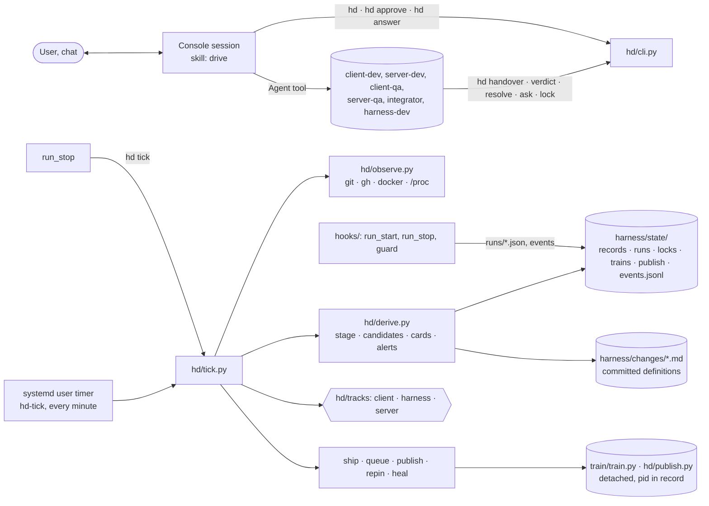
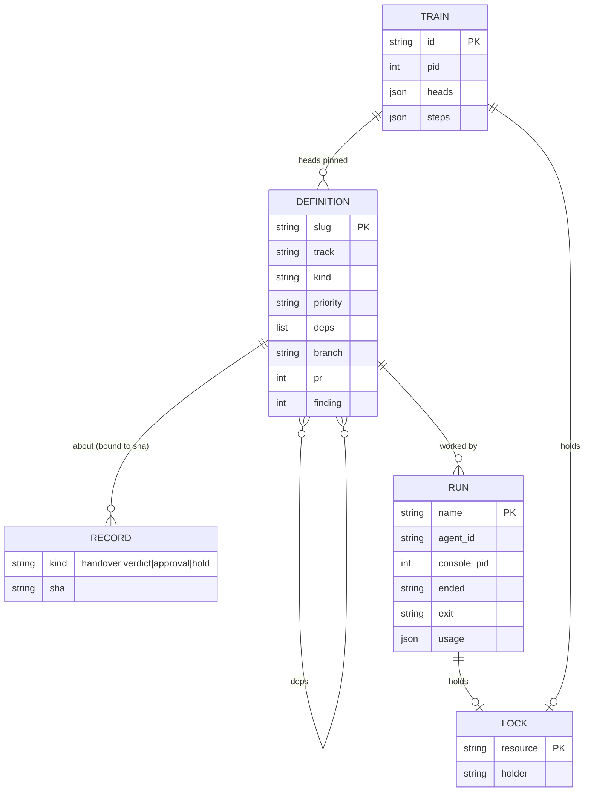
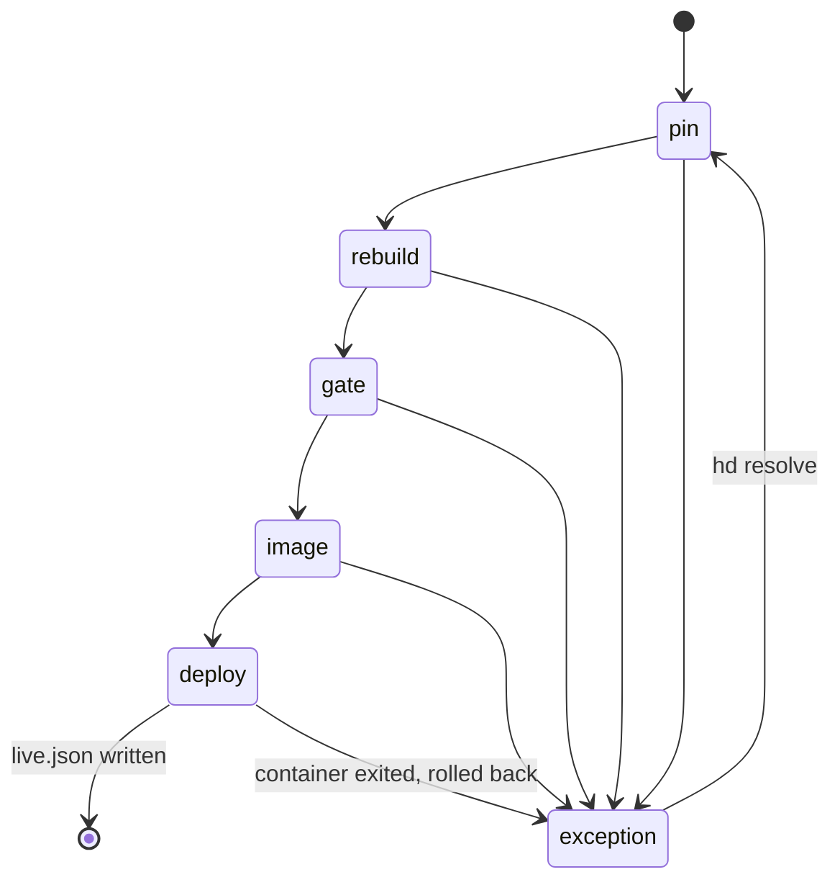

# Architecture of the harness (hd)

How it is built: the implementation that meets docs/PRD.md (R-n) for the problem in docs/PROBLEM.md. Each module's
docstring is its spec; this file is the map. Section 12 maps every requirement to its mechanism.

## 1. In one paragraph

A **change** is a committed definition file. Everything about where it is — its stage, whether an agent is working on
it, what needs the user — is **derived** on every read from facts: git refs, GitHub, docker, the process table and the
one record each actor owns (the dev's hand-over, QA's verdict, the user's approval, the hooks' run start and end, the
train's steps). `hd tick` is a short idempotent command, run every minute by a systemd user timer and after every agent
run; it observes, derives and acts (merge, queue a train, start a publish, heal). The **console session** (Claude Code,
the user in chat) spawns the agents the tick lists with the Agent tool and records the user's yes and answers; nothing
else depends on it being alive. Long work (a train, a publish) is a detached process the tick starts once and then only
observes by its pid and its step records.

## 2. Components



| Module | Responsibility |
|---|---|
| `hd.py`, `hd/cli.py` | the commands, each with a caller: console `hd`, `approve`, `answer`, `new`, `dod`; agents `handover`, `verdict`, `resolve`, `ask`, `lock`, `dod`, `show`; timer and hooks `tick`; user `cost`, `events` |
| `hd/defs.py` | definitions: read and write `harness/changes/<slug>.md` |
| `hd/records.py` | the state dir: records per change, runs, locks, trains, publish, `events.jsonl`; the state-dir lock |
| `hd/observe.py` | facts: refs of the three repos, `gh` PR state, checks, comments, docker containers and images, pid alive, the console pid of a hook |
| `hd/derive.py` | pure functions over facts: stage per target, alive runs and trains, capacity used, dispatch candidates, cards, questions, alerts |
| `hd/tick.py` | take the state-dir lock; observe; derive; act in order: heal, ship, tracks' step, start a train or a publish; emit; exit |
| `hd/heal.py` | the repairs of R28 |
| `hd/brief.py` | the agent brief from the definition and the stage |
| `hd/publish.py` | the detached publish process: the approved upstream sequence or the release |
| `hd/tracks/{client,harness,server}.py` | the per-track facts and actions (section 5) |
| `hooks/run_start.py`, `hooks/run_stop.py`, `hooks/guard.py` | R6–R8, R31 (section 7) |
| `train/train.py`, `train/image.sh`, `train/deploy.sh`, `train/Dockerfile.integration` | the train process and its steps (section 8) |
| `hd.yaml` | repos and remotes, branch prefixes, roles (capacity classes used, worktree), capacity numbers |
| `.claude/agents/*.md`, `.claude/skills/*` | role files (no hooks) and skills; `drive` is the console loop |

## 3. Data

**Definition** — `harness/changes/<slug>.md`, committed, written by people and devs (`hd new`, `hd dod`):
```yaml
slug: stile-approach
track: server            # client | server | harness
kind: change             # change | release (client) | local (server: test server only)
title: ...
priority: P1             # P0..P3
deps: []                 # slugs that must be live first
branch: fix/stile-approach   # only when it differs from <prefix>/<slug> (a review fix shares its PR's branch)
pr: 406                  # server: written by publish when the PR exists
finding: 2345678         # server: the maintainer comment or review id this change answers
---
## Change                (the spec; a server change names its accuracy spec)
## Definition of done    (checkboxes; `hd dod <slug> <n>` ticks)
```

**Records** — `harness/state/`, git-ignored, one owner each:
```
records/<slug>/handover.json   {sha, evidence, summary, items, ts}                 dev   (hd handover, after its check)
records/<slug>/verdict.json    {sha, verdict, checks[], findings[], ts}            QA    (hd verdict, after its check)
records/<slug>/approval.json   {sha, kind: upstream|release, ts}                   user  (hd approve)
records/<slug>/hold.json       {text, by: <run>|tick|user, ts}                     agent (hd ask) · tick (R8) · user (hd answer removes it)
runs/<slug>.<role>.<n>.json    {agent_id, role, change, head, console_pid, started, ended, exit, last, usage{input, output, cache_read, cache_creation}}   hooks
locks/<resource>.json          {holder: <run>|<pid>, purpose, since}               holder (hd lock take|release)
trains/<id>.json               {pid, heads{slug: sha}, upstream_main, steps{pin, rebuild, gate, image, deploy: {ok, detail, ts}}, exception, resolution}   train.py
publish/<slug>.json            {pid, sha, kind, steps{push, pr, ci, comment, ready | tag, release: {ok, detail, ts}}}   publish.py
live.json                      {integration, image, rollback, upstream_main, since} deploy.sh
events.jsonl                   append-only, UTC                                    everyone, through records.event
```
`evidence/<slug>/` (this repo, git-ignored): the dev's and QA's files (`accuracy.md`, `pr-title.txt`, `pr-body.md`,
`pr-comment.md`, `gate.md`, logcat extracts, data-tool dumps, the release's APK and notices).



## 4. Derivation

Nothing in this section is stored. `head(slug)` is the track's ref for the dev's output (section 5).

| Fact | Read from |
|---|---|
| head | the track's ref (`git ls-remote` on the fork or the client origin; `git rev-parse` in this repo) |
| handed, verified, approved at head | the record exists and `record.sha == head` |
| live | the track's `live(sha)` |
| published, done (server) | `gh pr view`: ready and head == sha; `upstream/main` contains sha |
| run alive | run record without `ended` and `/proc/<console_pid>` exists |
| train or publish alive | `/proc/<pid>` exists; a dead pid without a final step is an exception |
| lock free | the holder run is not alive or the holder pid is dead |
| capacity used | the classes of alive runs (the role's) and alive trains (`build`, `image`) |

```mermaid
stateDiagram-v2
  [*] --> defined: definition file exists
  defined --> ready: definition of done present, every dep live
  ready --> dev: a dev run is alive, or head exists with no hand-over at head
  dev --> handed: handover.sha == head
  handed --> verified: verdict.sha == head (server, release); handed itself (client, harness)
  verified --> approved: approval.sha == head (server upstream, release)
  approved --> published: PR ready at head · release exists
  handed --> live: target contains head (ship: client, harness · train: server)
  published --> done: upstream main contains head
  live --> done: client, harness, server local
  dev --> ready: head moved past the hand-over (its records are void)
```


A server change has two targets that advance independently: `test-server` (handed → live) and `upstream` (verified →
approved → published → done). `hd` shows both columns.

**Dispatch** (`derive.candidates`): for each change without a hold and without an alive run, the role needed is `dev`
when ready and not handed at head; the track's verify role when handed and not verified at head; `integrator` for a
train at exception without a resolution. Order: priority, then `created`. Take while every class the role uses has a free
slot. A change whose last run at this head and role ended without a record carries a hold (R8) and is skipped. Nothing is
written; the console reads the list and spawns.

## 5. Tracks (hd/tracks)

One module per track; these functions are the whole interface:

| Function | client | harness | server |
|---|---|---|---|
| `head(slug)` | `origin/client/<slug>` | local `harness/<slug>` | fork `dev/<slug>` |
| `live(sha)` | `origin/master` contains | `main` contains | `live.json.integration` contains |
| `done(sha)` | live | live | `upstream/main` contains (kind local: live) |
| `verify_role` | none (kind release: `client-qa`) | none | `server-qa` |
| `check(slug, sha, evidence)` | repack log, device evidence, netqa when networking changes | tests of the touched requirements pass | spec present, one change, off upstream main, PR text files, no stacked commit |
| `ship(slug, sha)` | merge into `master` (`--no-ff`), push | merge into `main` (`--no-ff`), push | queue `{slug: sha}` for the train |
| `cards()` | kind release: verified and unapproved → tag card | — | verified and unapproved → contribute card; a finding filed on a ready PR → draft card |
| `publish(slug, sha)` | tag at sha; `gh release create` with the gate's APK and notices | — | push `dev/<slug>` → the public branch; open the PR if none; CI green at sha; comment; ready |
| `step()` | — | — | file review-fix changes (R22); when `upstream/main` moved: fast-forward fork `main`, drop merged branches, queue a train (R21) |

The server module owns the PR conversation; the core knows nothing about PRs, CI or reviews.

Branches: client `client/<slug>`; harness `harness/<slug>`; server `content/<slug>`, `fix/<slug>` (public) and
`local/<slug>`; the dev's ref on the fork is always `dev/<slug>`.

## 6. The console loop (skill `drive`)

```mermaid
sequenceDiagram
  participant C as Console
  participant H as hd
  participant U as User (chat)
  loop paced by /loop
    C->>H: hd  (spawns with brief paths, cards, questions, alerts, alive runs and trains)
    C->>C: Agent tool per spawn (subagent_type=role, prompt=brief, isolation=worktree per role)
    C->>U: each card in full; each question
    U-->>C: yes · fix first · no · an answer
    C->>H: hd approve <slug> <sha> · hd hold <slug> "<fix>" · hd answer <slug> "<text>"
  end
```
Four verbs. The console never runs an upstream or release command; it records the yes and the tick's publish process
does the work. The console never enters a worktree. A new card or question is pushed once (PushNotification).

## 7. Hooks and guards

| Hook | Event | Does |
|---|---|---|
| `run_start.py` | `SubagentStart` | writes `runs/<slug>.<role>.<n>.json` from the Agent tool's prompt (first line `Harness change \`<slug>\` run \`<name>\``), the hook's `agent_id`, `agent_type`, and the console pid (the hook's claude ancestor) |
| `run_stop.py` | `SubagentStop` | blocks the stop when the change still needs the run's record (hand-over, verdict, resolution or a question); otherwise writes `ended`, `exit`, `last` and `usage` summed from `agent_transcript_path`, then runs `hd tick` |
| `guard.py` | `PreToolUse: Bash` (every role and the console) | one table: writes to OpenRune denied to all; fork pushes allowed only to the role's refs (`dev/<slug>`, `gate/*`, `docs`, `local/server-tools`); deploy, image build and docker writes on the live stack denied; `hd approve` allowed to the console only; targets resolved by remote URL and ref; every denial an event |

All three are wired in the committed `.claude/settings.json`; role files carry no hooks. `publish.py` and `train.py`
run outside Claude Code and check the approval record and the locks themselves.

```mermaid
sequenceDiagram
  participant C as Console
  participant S as run_start
  participant A as Agent
  participant E as run_stop
  participant T as hd tick
  C->>A: Agent tool (brief)
  S->>S: runs/<name>.json {agent_id, console_pid, head}
  A->>A: work; hd handover | verdict | resolve | ask (checked, refused if incomplete)
  A-->>E: stop
  E->>E: record on disk? no: block with the command to run. yes: ended, exit, usage
  E->>T: hd tick
  T->>T: ship · queue train · start publish · heal
```

## 8. Train and publish

**Train** (`train/train.py <id>`): started by the tick when the server queue is non-empty and no train is alive; takes
`integration` (and `live-server` for the deploy) by its pid; steps `pin` (every queued head), `rebuild` (`integration`
from upstream `main` in recorded order with recorded resolutions, lease push), `gate` (fork `qa.sh` on the tree),
`image` (`image.sh`: cache fixes, `COPY --from` the live image's keys, key hash check, boot container), `deploy`
(`deploy.sh`: rollback tag, `compose up -d --no-deps`, wait for "Server ready in", roll back when the container exits);
each step's result into `trains/<id>.json`; `live.json` on success. The tick only observes: pid dead without `deploy.ok`
or `exception` → `exception` with the last step's detail → one integrator run → `hd resolve <id> "note"` → the tick
starts the train again from `pin`.

**Publish** (`hd/publish.py <slug>`): started by the tick when `approval.sha == head` and no publish is alive; the
track's `publish`; steps into `publish/<slug>.json`; a red CI stops before `comment`, and the card shows the step. Each
step is observed before it is attempted again (a re-run resumes).



## 9. Healing (R28)

| Fault | Fact | Repair |
|---|---|---|
| console died | `console_pid` dead, run has no end | end runs `console-died`, free their locks |
| agent ended without its record | run ended, no record at head, exit not `console-died` | hold with `last` (R8) |
| tick died mid-work | the timer starts the next; the state-dir lock is `flock`, released with the process | none needed |
| two ticks | `flock` on `harness/state/.lock` | the second exits |
| lock held by a dead holder | holder run not alive or pid dead | reclaim |
| train or publish process died | pid dead, no final step | `exception`; a train books an integrator; a publish shows the step on the card |
| orphan container (`qa-*`, `hd-boot-*`), clone (`openrune-work/agents/<run>`), worktree (`.claude/worktrees/*`), gate clone | owner run or train not alive | remove |
| images beyond live and rollback | `live.json` names both | `docker rmi` the rest |
| upstream `main` moved | `upstream/main` ≠ `live.json.upstream_main` | the server track's `step` |
| Docker engine down, BlueStacks absent, `gh` unauthenticated, usage limit | `docker info`, the Windows process list, `gh auth status`, the console's error | alert in `hd` (R29) |

Every repair is one event. Nothing retries on a schedule.

## 10. Locks and capacity

`locks/<resource>.json` for `integration`, `live-server`, `ghidra`: `hd lock take <res> --run <name>|--pid <pid>`;
denied while held by a live holder; free when the holder is not alive (section 4). `train.py` and `deploy.sh` refuse
without theirs. Capacity (`hd.yaml`): `agent`, `build`, `image`, `client`, `device` with their slots; each role names
the classes it uses; a train uses `build` and `image`; `derive.capacity` counts alive runs and trains.

## 11. Run and test

```
systemctl --user enable --now hd-tick.timer        # every minute: python3 ~/osrs-harness/hd.py tick
python3 ~/osrs-harness/hd.py                       # the console's list (status, spawns, cards, questions, alerts)
python3 ~/osrs-harness/hd.py tick                  # one tick by hand; --dry-run derives and prints
python3 ~/osrs-harness/hd.py cost | events
python3 -m unittest discover -s tests              # a test per requirement; FakeObserver stands in for git, gh, docker, /proc
```

## 12. Requirements to mechanisms

| Requirement | Mechanism |
|---|---|
| R1, R3, R4, R5 | `derive.py` reads only `observe` and `records`; `defs.py`; `.gitignore` (`harness/state/`, `evidence/`); no write path commits |
| R2 | no sleep-until loops in `hd/`; `publish.py`, `train.py`, `deploy.sh` poll for a fact and stop on the fact that it cannot come |
| R6, R7, R8 | `run_start.py`, `run_stop.py`, `derive.alive`, `heal` (`console-died`), `derive.candidates` |
| R9, R10, R17 | `derive.candidates`, `derive.capacity`, `brief.py`, `hd.yaml` |
| R11–R15 | `tracks.*.cards`, `hd approve`, `publish.py`, `hd ask`/`hd answer`, `hd` (cli), the `drive` skill |
| R16 | `records.lock`, `train.py`, `deploy.sh` |
| R18–R23 | `tracks/server.py`, `train/train.py`, `publish.py`, skills `server-track`, `accuracy-check` |
| R24–R26 | `tracks/client.py`, `tracks/harness.py`, kind `release` |
| R27–R30 | `hd-tick.timer`, `run_stop.py` → `hd tick`, `flock`, `heal.py`, `derive.alerts`, `records.event`, `hd cost` |
| R31, R32 | `guard.py`; role files; skills `test-instances`, `network-qa` |
