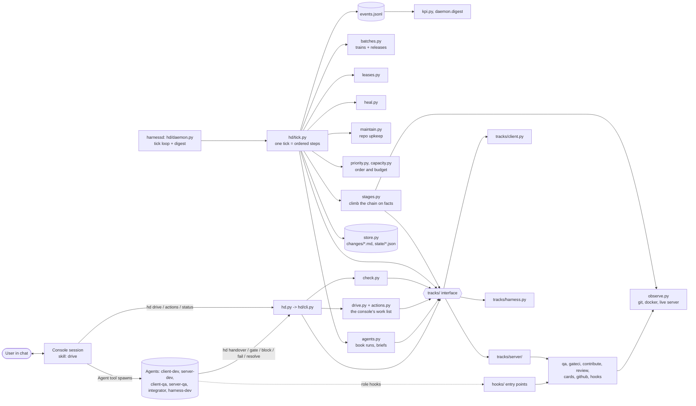
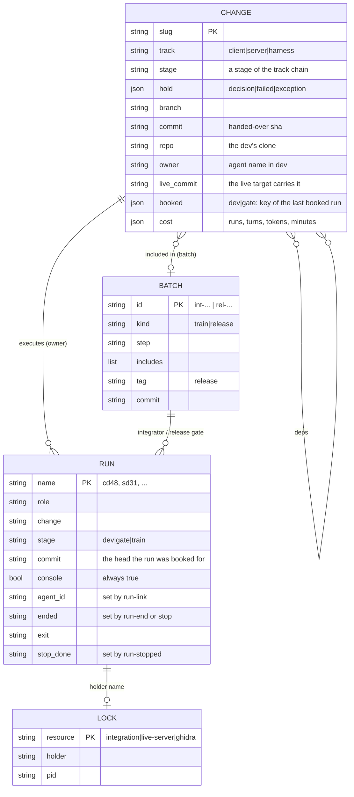
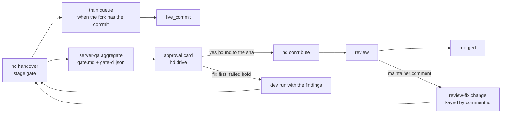

# Architecture of the harness (hd)

How it is built. The problem, workflow and rules (BR-*) are in docs/PROBLEM.md; this file is the mechanism that implements them. Each module's docstring is its spec; this file is the map.

## 1. What it does, in one paragraph
Two products move to their live targets: the client (RuneLite plugins in the OSRS Android app; live = `master` contains
the commit; releases are APKs) and the test server (OpenRune fork; live = the fork's `integration` branch runs in the
live container; contributed upstream as PRs to OpenRune/OpenRune-Server). The unit of work is a **change**, a markdown
file. A daemon (`hd start`) observes git, GitHub, CI, docker and locks every tick, derives each change's stage from
those facts, merges, trains, deploys, heals and books agent runs. A **console session** (Claude Code, with the user in
chat) is the daemon's hands: it spawns the agents the daemon books and performs upstream actions after the user's yes.
Agents (client-dev, server-dev, client-qa, server-qa, integrator, harness-dev) each execute one stage of one change.

## 2. Components and responsibilities
Two layers. The **core** orchestrates between the three tracks: changes, deps and priority, capacity, dispatch, holds, run
bookkeeping, the console driver. A **track** (client, harness, server) owns everything specific to its product and is
reached only through one narrow interface (section 2a); the core imports no track internals and says nothing about PRs, CI
or reviews.

| Core module | Responsibility |
|---|---|
| `hd.py`, `hd/cli.py` | the command line; the only interface for agents, the console and the user; each track registers its own subcommands |
| `hd/daemon.py` | the tick loop (detached process, `daemon.json`), `stop`, `status`, `digest` (news from events) |
| `hd/tick.py` | one tick: reconcile, ship/train, deploy, re-pin, gates, tracks, dispatch, metrics, heal, maintain, log; each step isolated |
| `hd/priority.py` | the one dispatch order: settle-first changes, effective priority (inherited across deps), age |
| `hd/capacity.py` | the capacity classes: usage counted from runs and batch steps, the first full class of a role |
| `hd/maintain.py` | the repo's upkeep: commit the change store, remove merged clean worktrees and branches, stale holds |
| `hd/stages.py` | the generic climb of a track's chain on its facts, booking keys; `derive()`, `next_executor()` |
| `hd/observe.py` | external truth (`Observer`; `FakeObserver` for tests): git refs (the clones, a dev's clone), docker, the live server, pids; `tracks.Observer` adds each track's mixin |
| `hd/check.py` | the hand-over check run by `hd handover`: the common items plus the track's; an incomplete hand-over is refused and nothing is recorded |
| `hd/store.py` | changes (front matter + body), records (`rec_save/rec_load`), holds, stages written by the daemon and `hd handover` only |
| `hd/leases.py` | locks on the shared resources (`integration`, `live-server`, `ghidra`): take, release, reclaim (section 10) |
| `hd/agents.py` | names, briefs, booking a run (record, owner, `agent request` event), link, end, stop, lingering |
| `hd/batches.py` + `train/` (`integrate.py`, `image.sh`, `deploy.sh`) | trains (queue, pins, rebuild, gate, image, deploy, re-pin) and release batches |
| `hd/ship.py` | the merge of a handed-over client or harness change into its live target (`--no-ff`; the client push only) |
| `hd/heal.py` | idle locks, lingering runs, a dev run ended without hand-over, dead containers, dead batch processes |
| `hd/actions.py` | the user's list: every track's cards plus the release batches (section 8) |
| `hd/drive.py` | the console's work list (section 7) |
| `hd/kpi.py`, `hd/metrics.py`, `hd/events.py` | the append-only event log, KPIs derived from it, derived progress metrics |
| `hooks/` | guard entry points: they parse the command and ask the server track's `hooks.py` (section 11) |
| `.claude/agents/*.md`, `.claude/skills/*` | role files (each wires its hooks) and skills (`drive` is the console's loop) |

### 2a. Tracks (hd/tracks)
`tracks.of(change)` returns the track object; its methods are the whole interface (defaults in `base.py`):

| Method | Meaning |
|---|---|
| `chain(ch)` | the stages of the change, `backlog ... terminal` |
| `tip(ch, obs)`, `open_stages(ch)`, `moves_expected(ch)` | where the commit lives; where a moved branch re-enters at ready; a tip that moves on is normal |
| `facts(ch, obs)` | `{stage: (met, why)}` for the stages after `gate`, plus `live` and `tip`; `waiting(stage, ch)` words the first unmet one |
| `executor(ch)`, `finding_set(ch)`, `settles_first(ch)` | the verifier role needed now; the findings a dev run is given (the no-loop key); the change settles work already in front of an external party |
| `reconcile(ctx, slug, ch)`, `ship(ctx, slug, ch)`, `step(ctx)` | per change after the stage is derived; per handed-over change (merge or queue); once per tick |
| `needs_you(ch, obs, idx)` | the track's cards for the user, from observed facts alone |
| `check_items(ch, obs, ev, files)`, `default_dod(spec)`, `records_repo` | the hand-over check beyond the common items; the definition of done `hd new --server-dod` writes; the dev's clone is kept |
| `brief(ch, stage)`, `run_valid(run, ch)`, `record_gate(ch, verdict, note)` | brief lines; why a booked verifier run no longer applies; `hd gate` |
| `register(sp)`, `keys`, `migrate_stage(meta)` | the track's subcommands and front-matter keys; stages of a retired chain |

| Track | Module | Chain | Settings |
|---|---|---|---|
| client | `tracks/client.py` (on `target.py`) | `backlog ready dev gate live`: `master` contains the commit; build evidence at hand-over; the release flow stays in the core | `tracks.client` |
| harness | `tracks/harness.py` (on `target.py`) | `backlog ready dev gate live`: this repo's `main` contains the commit | `tracks.harness` |
| server | `tracks/server/` | `backlog ready dev gate contribute review merged` (`local/*`: `... gate live`) | `tracks.server`: `reviewers`, `ci_equivalence` |

Server track modules: `__init__` (the track), `qa` (QA's record and its checks), `gateci` (`hd gate-ci`: the scratch
merge with upstream main, the fork's `gate/<slug>`, CI observed, the diff scan), `cards` (the approval card, the
draft card), `contribute` (`hd contribute`: push, open, CI, comment, ready, review as observed steps), `review` (maintainer
findings filed once as review-fix changes), `github` (the PR bucket and the fork's CI as observer mixins, the
CI-equivalence table), `hooks` (the hook rules). `tracks.Observer` / `FakeObserver` are the core observers with the
mixins. Releases, trains and the observer's fork and docs reads are still the core's.

## 3. Data model
Committed: `harness/changes/<slug>.md` (YAML front matter, `## Change`, `## Definition of done` checkboxes, `## Log`),
`harness/policy.yaml`. Git-ignored `harness/state/` holds records; everything in it is a cache of facts or an audit log.

Per change, in its evidence dir `re/evidence/<slug>/`: the track's evidence (server: `gate.md`, QA's record bound to the
commit; `gate-ci.json`, the scratch merge's CI result and diff findings; `accuracy.md`; `pr-title.txt`, `pr-body.md`,
`pr-comment.md`). Server-track change keys: `upstream_pr`, `finding`, `review_seen`.
State files: `events.jsonl` (append-only), `leases/<res>.json` (the locks), `runs/<name>.json` + `<name>.log` (the brief),
`batches/<id>.json`, `queue.json` (train queue), `live.json` (what the live server runs), `images/`, `deploys/`,
`view/` (last tick, waiting words, stale holds), `actions/<id>.<part>.md` (text files for the commands of an action), `gates/<slug>/or` (the gate's scratch clone),
`release.request` (`{tag}`), `counters.json` (agent names), `daemon.json`, `digest.json`, `digest.md`.

## 4. Observed vs recorded
| Fact | Where it lives | How it changes |
|---|---|---|
| A change's stage from `gate` on | derived each tick from the facts the track reads (git, its records, docker, ...) | `stages.derive`; a disagreement is repaired and logged as `drift` |
| `dev` and the hand-over | recorded (dispatch; `hd handover`, which runs the check) | `store.set_stage`, never by an operator |
| `live_commit` | observed: the live target carries the commit (server: the integration pin and the live server) | tick `reconcile`, the train; independent of the server's upstream stages |
| Holds | recorded (`hd fail`, `hd hold`, the daemon's no-loop and ship failures); `decision`, `failed`, `exception` only | `hd hold/unhold`; the reconciler never clears one |
| Waiting on a dep | derived each tick from `deps` and the deps' observed stages; never stored | `hd block --by` adds the edge |
| QA's aggregate | the local file `gate.md`, bound to the commit | `hd gate` checks it; a new commit voids it |
| A card's work done | observed in the world (the release exists; server: the PR is ready at the commit) | no record; the card leaves `hd actions` |
| User's OK | the chat itself | nothing is stored; commands run only after it |
| Release published | observed: `gh release view <tag>` | tick `gates` step sets the batch `published` |
| Run spawned / stop done | recorded by the console's own commands (`run-link`, `run-stopped`) | they only remove items from the drive list |
| Lock in use | the holder's run, pid or container is alive; no timeouts decide anything | `leases.idle` |
No decision uses elapsed time: a step ends on its record, its process or its container.

## 5. The change lifecycle
The stage names are the track's chain (section 2a); below `gate` the recorded stage stands, from `gate` on the track's facts
decide.

```mermaid
stateDiagram-v2
  [*] --> backlog: hd new --backlog / no definition of done
  backlog --> ready: has a definition of done, deps live
  ready --> dev: dispatch (agent run booked, owner set)
  dev --> gate: hd handover (its check passed)
  dev --> ready: run ended without hand-over / blocked
  gate --> live: client: master contains the commit; harness: main contains it (ship merges); local/*: the test server runs it
  gate --> contribute: server: QA's record exists at the commit
  contribute --> review: server: hd contribute after the user's yes
  review --> merged: server: merged upstream
  gate --> ready: branch moved past the handed-over commit
  contribute --> ready: branch moved past the handed-over commit
  live --> [*]: client, harness, local/* (terminal)
  merged --> [*]
```

Server flow after the hand-over, two independent outputs:

`live_commit` is the live target's own fact, set by the tick (client, harness) or the train (server); a dependent change waits
for it only. A QA finding sets no hold and books no dev. `next_executor`: `ready`, or a `failed` hold at or after `gate`
(an operator asked for a fix, or a train failed), needs a dev; otherwise the track's `executor` (the server's `gate`: a
handed-over change that is not local-only with no QA record at its commit); a `decision`/`exception` hold needs
nothing, nor does a change before `gate` with an open dep (derived). Before a run is booked, `stages.would_loop` compares the booking key (head sha, the track's finding set; for a
verifier the head) with the last booked one: equal means a durable `decision` hold and no run (`hd unhold`, `hd block`,
`hd fail` and a branch move reset it). Unknown facts (gh down) never regress a stage.

A change whose `finding` is set is a review-fix: same branch and PR, full chain; the parent stays at `review` while the PR is
open. Findings are the comments and reviews newer than the parent's `review_seen` by anyone but the fork owner and bots
(approvals and dismissals excluded).

Harness track: branches and the live target are read in this repo (`tracks/harness.py`); the target is policy
`tracks.harness.live_target` (`main`). A `harness/<slug>` branch passes the check while main lacks the commit; a change
handed over on `main` passes while main contains the commit. The daemon merges `harness/*` into main (`--no-ff`,
trailer `Co-Authored-By: Claude <noreply@anthropic.com>`), locally, never pushed. `hd dod <slug> <n>...` ticks
definition-of-done items on the store.

## 6. The tick (tick.py)
Order, each step in its own try/except (a failure is an `error` event): 1 reconcile (derive stages, `live_commit`, a moved
branch re-enters at ready, each track's `reconcile`) · 2 ship/train (each track's `ship` for its
handed-over changes: merge or queue; `batches.advance`) · 3 deploy (`live-server` lock, `deploy.sh`) · 4
re-pin (upstream main moved) · 5 gates (release rule makes a release batch; release record sets `gated`; an observed
release sets `published`; the release gate agent is booked) · 6 tracks (each track's `step`) · 7 dispatch (ready changes and gates x free
capacity, in `priority.rank` order; the no-loop check; integrator per train exception) · 8 metrics (recount on a client
change live, a deploy, a re-pin) · 9 heal · 10 maintain · the `tick` event.
`--dry-run` observes and reports only.

### Dispatch and hand-over
```mermaid
sequenceDiagram
  participant D as harnessd (tick)
  participant S as store / events
  participant C as Console (drive skill)
  participant A as Agent (role)
  D->>S: agents.spawn: set owner, write brief (runs/<name>.log), run record, event "agent request"
  C->>D: hd drive (spawn list: runs without agent_id)
  C->>A: Agent tool (subagent_type=role, prompt=brief, isolation worktree for client-dev/client-qa/harness-dev)
  C->>S: hd run-link <name> <agent-id>
  A->>S: hd handover <slug> --branch --commit --evidence [--repo] (the check runs now; refused or stage gate)
  A->>A: stop hook task_stop: result on disk? slot_stop: no lock held?
  A-->>C: completion notification
  C->>S: hd run-end <name> --tokens --turns (cost on change, locks freed, owner cleared)
  D->>S: next tick: ship / train / QA booked from the stage gate
```
A run whose change no longer names it (owner cleared, batch step moved) is `lingering`; heal stops it (`agent
stop-request` event, run ended `stopped:<why>`) and `hd drive` lists the TaskStop for the console.

## 7. The console driver loop
`hd drive` prints, from run records, change files, batches and observed state: (a) spawns (booked runs with no
`agent_id`: name, role, change, brief path, worktree yes/no), (b) stops, (c) actions needing the user's OK with exact
commands, decisions (`decision` holds), (d) exceptions (a train at `exception` whose integrator ended, `exception`
holds, `failed` holds no dev will pick up). The `decision` holds are the user's "needs you": an agent's question, or the
no-loop hold. Nothing in it is stored: each item disappears when its fact changes.
The loop itself (spawn, link, end, ask, run, repeat; never EnterWorktree in the console) is `.claude/skills/drive/SKILL.md`.

## 8. The user's list (actions.py)
`pending_actions` collects every track's `needs_you` cards and the gated release batches. A card carries the exact commands,
the text files they post, the record, check lines, findings, diff range, observed steps and caveats; nothing is recorded,
completion is the observation that removes it. Release batches need `tag-release` (one `gh release create <tag> --target
<commit>` with the APK) or `choose-tag` (`hd release-request vX.Y.Z`).

Server cards (`tracks/server/cards.py`): `contribute` for a change at `contribute`, one command bound to the commit; `draft-pr`
for a review-fix change open on a PR that is ready.
```mermaid
sequenceDiagram
  participant Q as server-qa
  participant C as Console
  participant U as User (chat)
  participant G as GitHub
  Q->>Q: hd gate-ci, checks, gate.md
  Q->>C: hd gate <slug> PASS|FAIL (the record checked against the commit)
  C->>C: hd drive: the card (verdict, checks, findings, PR text, diff, steps)
  C->>U: AskUserQuestion: approve this commit / fix first / no
  U-->>C: approve
  C->>G: hd contribute <slug> --approved <sha> (push, open, CI, comment, ready, review)
  C->>C: next tick: the PR is ready with the commit: stage review; the card is gone
```

## 9. Integration train and deploy (batches.py)
Train steps: `queued -> pinning -> rebuilding -> gating -> imaging -> imaged -> deploying -> live`, or `exception`
(then an integrator agent is booked; `hd resolve` / `hd resume`) or `failed`. One train at a time (the `integration`
lock). Release steps: `queued -> gating -> gated -> published | failed`.
```mermaid
sequenceDiagram
  participant T as tick
  participant B as batches
  participant L as locks
  participant X as image.sh / deploy.sh / qa.sh
  participant I as integrator agent
  T->>B: advance: handed-over server changes in queue.json
  B->>B: pin branches, rebuild integration (integrate.py), lease push
  B->>X: gate (qa.sh), image (image.sh, boot check)
  T->>L: daemon takes live-server
  B->>X: deploy.sh (rollback tag first, compose up --no-deps, wait "Server ready in")
  X-->>B: ready -> included changes live, live.json written; container exited -> auto-rollback -> exception
  B-->>I: on exception: brief with the stop output (booked, spawned by the console)
  I->>B: hd resolve <batch> "note" -> resume from the failed step
```
A re-pin fast-forwards the fork's main when upstream main moved and starts a train.
A resume after a gate failure re-runs the train from pinning when the tools branch head differs from the batch's tools commit (entries the integrator removed from `integration.txt` leave the batch), else restarts the gate.

## 10. Locks (leases.py)
Mechanism only, for the three resources that exist once: `integration` (the integration clone and its lease push; the
daemon holds it for one train), `live-server` (the daemon holds it for a deploy; `deploy.sh` refuses without it) and
`ghidra` (the one project writer; an agent takes it while it writes). A lock is a record (holder, purpose, since, pid or
container); a take by another holder is denied. It is idle when its holder's run ended or its attached pid or container
is dead; heal reclaims it with that evidence. `run-end` and `stop` free what the run held.

Dispatch waits on capacity classes only (section 10a); client instances are not locks (skill `test-instances`). A deploy restarts the live server without waiting for any client.

### 10a. Capacity and priority
Policy `capacity` names the classes and their slots (`agent`, `build`, `client`, `image`); `agents.roles.<role>.uses` and
`batches.uses.<step>` name what a run or a train step holds. `capacity.used` counts runs not ended and open batches at a
step that uses a class; `capacity.full(role, ...)` names the first full class of a role. A candidate whose role does not
fit stays unbooked and shows as stalled; nothing is queued or locked. `hd lint` reports a class a role or step uses
that `capacity` does not define.

`priority.rank(change, idx)` is the dispatch order, a pure function of the store: settle-first (the track's
`settles_first`, enabled by policy `settle_first`), then `effective` priority (the change's own, or the highest of the
unfinished changes that list it as a dep while it is not live, transitive, cycle-safe), then `created`.

### 10b. Maintenance
`maintain.run` is the tick's last step, on the repo that holds the change store: `.claude/worktrees` into
`.git/info/exclude`; one pathspec-only commit of `harness/changes` when only store files differ and the branch is the
harness live target; while no run is alive, clean worktrees under `.claude/worktrees/` and local branches merged into the
live target removed (`git worktree remove`, `git branch -d`, never forced). `stale_holds` (a hold on a finished change, a
dep naming no change) is cached in `view/stale` and printed by `hd status`. `--dry-run` reports what is due and changes
nothing.

## 11. Hooks and guards
| Hook | Loaded by | Rule |
|---|---|---|
| `deny_publish.py` (`--fork-writes`, `--docs-writes`) | every agent role file | agents cannot push, write to GitHub, deploy or touch integration, nor run `hd contribute`; server-dev may write to the fork, server-qa to the fork's docs branch and `gate/*` only; pushes to OpenRune stay denied; image builds, deploys and docker or compose writes on the live stack (`osrs-openrune*`) are denied to every role; every denial is an event |
| `task_stop.py` | harness-dev, integrator, server-qa | cannot end without a hand-over / QA aggregate / resolution on disk |
| `slot_stop.py` | no role file | stops an agent ending while holding a lock |
| `qa_write_scope.py` | client-qa, server-qa | QA writes only its records |
| `publish_gate.py`, `github_scope.py` | every session, when wired in `.claude/settings.json` | client release tags need their record; the server track's rules (`tracks/server/hooks.py`): `hd contribute` needs QA's record at the commit and an approval naming it, a direct upstream PR needs the record; other upstream writes and pushes to a fork branch backing an open PR prompt the user; fork actions (`gate/*` pushes, fork CI) never prompt |
The console session does not load `deny_publish.py`: it can publish, which is why it asks the user in chat first.

## 12. Run and test
```
python3 ~/osrs-harness/hd.py start --interval 60     # the tick loop; hd stop && hd start after a code change
python3 ~/osrs-harness/hd.py drive                   # the console's list
python3 ~/osrs-harness/hd.py status | actions | agents | events | digest | lease status | batches | tick --dry-run
```
`python3 -m unittest discover -s tests`: a test per rule (`test_hd_*.py`, `test_hooks.py`, ...). `hd_helpers.sandbox`
points the store, state, events and policy at a temp dir; its policy is the live structure with the numeric knobs the
tests rely on pinned (`write_test_policy`). `FakeObserver` stands in for git, GitHub and docker.
