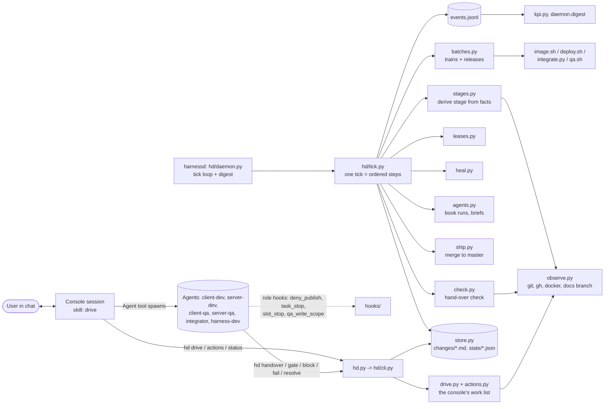
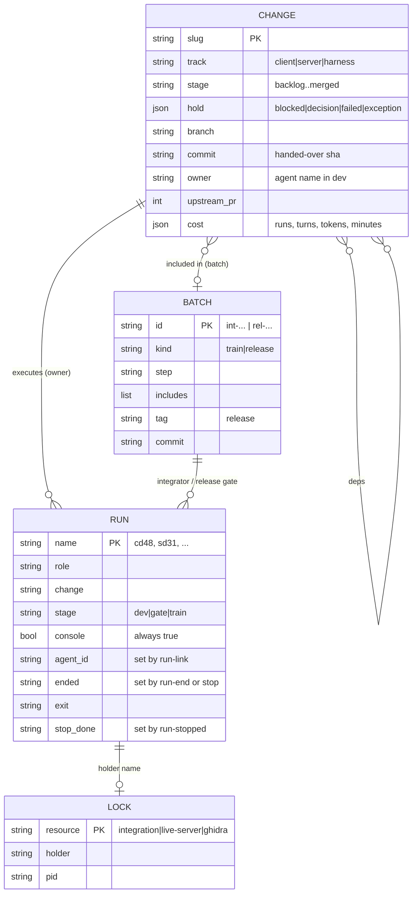
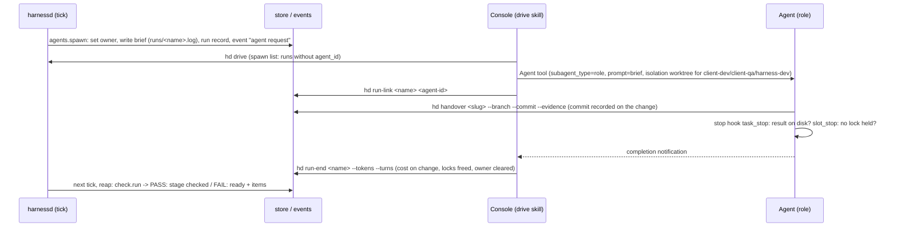

# Architecture of the harness (hd)

How it is built. The problem, workflow and rules (BR-*) are in docs/PROBLEM.md; this file is the mechanism that implements them. Each module's docstring is its spec; this file is the map.

## 1. What it does, in one paragraph
Two products move to their live targets: the client (RuneLite plugins in the OSRS Android app; live = `master` contains
the commit; releases are APKs) and the test server (OpenRune fork; live = the fork's `integration` branch runs in the
live container; contributed upstream as PRs to OpenRune/OpenRune-Server). The unit of work is a **change**, a markdown
file. A daemon (`hd start`) observes git, GitHub, CI, docker and locks every tick, derives each change's stage from
those facts, merges, trains, deploys, heals and books agent runs. A **console session** (Claude Code, with the user in
chat) is the daemon's hands: it spawns the agents the daemon books and performs upstream actions after the user's yes.
Agents (client-dev, server-dev, client-qa, server-qa, integrator, harness-dev) each execute one stage of one change.

## 2. Components and responsibilities

| Module | Responsibility |
|---|---|
| `hd.py`, `hd/cli.py` | the command line; the only interface for agents, the console and the user |
| `hd/daemon.py` | the tick loop (detached process, `daemon.json`), `stop`, `status`, `digest` (news from events) |
| `hd/tick.py` | one tick: reconcile, reap, ship/train, deploy, re-pin, gates, dispatch, metrics, heal, log; each step isolated |
| `hd/stages.py` | the lifecycle and one observable precondition per stage per track; `derive()`, `next_executor()` |
| `hd/observe.py` | external truth (`Observer`; `FakeObserver` for tests): git refs, fork CI, PRs, release, docs branch, docker, pids |
| `hd/check.py` | the hand-over check: claims of a hand-over verified against evidence (the `checked` precondition); a server change's CI fact is the upstream PR's checks at the handed-over commit (a passing fork run is accepted too); no PR at that commit reads `CI pending` and waits, it neither fails nor re-dispatches a dev |
| `hd/store.py` | changes (front matter + body), records (`rec_save/rec_load`), holds, stages written by the daemon only |
| `hd/leases.py` | locks on the shared resources (`integration`, `live-server`, `ghidra`): take, release, reclaim (section 10) |
| `hd/agents.py` | names, briefs, booking a run (record, owner, `agent request` event), link, end, stop, lingering |
| `hd/batches.py` + `train/` (`integrate.py`, `image.sh`, `deploy.sh`) | trains (queue, pins, rebuild, gate, image, deploy, re-pin) and release batches |
| `hd/ship.py` | checked client and harness changes merge into their live target (`--no-ff`; the client push only) |
| `hd/heal.py` | idle locks, lingering runs, a dev run ended without hand-over, dead containers, dead batch processes |
| `hd/actions.py` | what needs the user's OK, computed from observed state (section 8) |
| `hd/drive.py` | the console's work list (section 7) |
| `hd/kpi.py`, `hd/metrics.py`, `hd/events.py` | the append-only event log, KPIs derived from it, derived progress metrics |
| `hooks/` | guards (section 10) |
| `.claude/agents/*.md`, `.claude/skills/*` | role files (each wires its hooks) and skills (`drive` is the console's loop) |

## 3. Data model
Committed: `harness/changes/<slug>.md` (YAML front matter, `## Change`, `## Definition of done` checkboxes, `## Log`),
`harness/policy.yaml`. Git-ignored `harness/state/` holds records; everything in it is a cache of facts or an audit log.

State files: `events.jsonl` (append-only), `leases/<res>.json` (the locks), `runs/<name>.json` + `<name>.log` (the brief),
`batches/<id>.json`, `queue.json` (train queue), `live.json` (what the live server runs), `images/`, `deploys/`,
`checks/`, `view/` (last tick, waiting words), `actions/<id>.<part>.md` (text files for the commands of an action),
`release.request` (`{tag}`), `counters.json` (agent names), `daemon.json`, `digest.json`, `digest.md`.

## 4. Observed vs recorded
| Fact | Where it lives | How it changes |
|---|---|---|
| A change's stage (live, gated, published, merged) | derived each tick from git, CI, GitHub, docker, the docs-branch records | `stages.derive`; a disagreement is repaired and logged as `drift` |
| `dev`, `checked` | recorded by the daemon (dispatch; hand-over check) | `store.set_stage`, never by an operator |
| Holds | recorded (agents' `hd block/fail`, daemon, console) | `hd hold/unhold`, `gate FAIL`, check |
| Upstream action done | observed (PR at the commit, release exists) | no record; the action leaves `hd actions` |
| User's OK | the chat itself | nothing is stored; commands run only after it |
| Release published | observed: `gh release view <tag>` | tick `gates` step sets the batch `published` |
| Run spawned / stop done | recorded by the console's own commands (`run-link`, `run-stopped`) | they only remove items from the drive list |
| Lock in use | the holder's run, pid or container is alive; no timeouts decide anything | `leases.idle` |
No decision uses elapsed time, except the train debounce, gate and image timeouts and the deploy-ready timeout still
in policy (open work: docs/HANDOFF.md).

## 5. The change lifecycle

```mermaid
stateDiagram-v2
  [*] --> backlog: hd new --backlog / no definition of done
  backlog --> ready: has a definition of done, deps live
  ready --> dev: dispatch (agent run booked, owner set)
  dev --> checked: hand-over check PASS
  dev --> ready: check FAIL (items listed) / run ended without hand-over / blocked
  checked --> live: client: client repo master contains the commit; harness: this repo main contains it (ship merges)
  checked --> live: server: pinned in integration and the live server runs it (train + deploy)
  live --> gated: server: PASS record at the commit on the fork docs branch
  gated --> published: server: OpenRune PR open, not draft, at the commit
  published --> merged: upstream main contains the commit
  live --> ready: branch moved past the handed-over commit (BR-C2)
  live --> [*]: client, harness, local/* (terminal)
  merged --> [*]
```

Holds (`blocked`, `decision`, `failed`, `exception`) overlay any stage; they never are a stage. `next_executor`: `ready`
or a `failed` hold on ready/live/published needs a dev; a live, non-local server change without a PASS record needs a
server-qa gate; a `blocked`/`decision`/`exception` hold needs nothing. Unknown facts (gh down) never regress a stage.

Harness track: branches and the live target are read in this repo (`stages.repo_of`); the target is policy
`tracks.harness.live_target` (`main`). A `harness/<slug>` branch passes the check while main lacks the commit; a change
handed over on `main` passes while main contains the commit. The daemon merges `harness/*` into main (`--no-ff`,
trailer `Co-Authored-By: Claude <noreply@anthropic.com>`), locally, never pushed. `hd dod <slug> <n>...` ticks
definition-of-done items on the store.

## 6. The tick (tick.py)
Order, each step in its own try/except (a failure is an `error` event): 1 reconcile (derive stages, deps to blocked holds)
· 2 reap (a change at dev with a commit gets the check) · 3 ship/train (checked client/harness changes merge; checked
server changes join the queue; `batches.advance`) · 4 deploy (`live-server` lock, `deploy.sh`) · 5 re-pin (upstream main
moved) · 6 gates (release rule makes a release batch; release record sets `gated`; an observed release sets
`published`; the release gate agent is booked) · 7 dispatch (ready changes x free slots, by priority;
integrator per train exception) · 8 metrics · 9 heal · the `tick` event. `--dry-run` observes and reports only.

### Dispatch and hand-over

A run whose change no longer names it (owner cleared, batch step moved) is `lingering`; heal stops it (`agent
stop-request` event, run ended `stopped:<why>`) and `hd drive` lists the TaskStop for the console.

## 7. The console driver loop
`hd drive` prints, from run records, change files, batches and observed state: (a) spawns (booked runs with no
`agent_id`: name, role, change, brief path, worktree yes/no), (b) stops, (c) actions needing the user's OK with exact
commands, decisions (`decision` holds), (d) exceptions (a train at `exception` whose integrator ended, `exception`
holds, `failed` holds no dev will pick up). Nothing in it is stored: each item disappears when its fact changes.
The loop itself (spawn, link, end, ask, run, repeat; never EnterWorktree in the console) is `.claude/skills/drive/SKILL.md`.

## 8. Upstream actions and releases (actions.py)
A gated server change (stage `gated`, branch and commit) needs `open-pr` (no upstream PR), `ready-pr` (draft at the
commit) or `update-pr` (PR head behind: push the commit to the fork branch, then comment). A gated release batch needs
`tag-release` (one `gh release create <tag> --target <commit>` with the APK) or `choose-tag` (no tag yet: the user picks,
`hd release-request vX.Y.Z`). PR text comes from the fork's docs branch (`pr-texts/<slug>.title|.upstream.body|.update.md`).
```mermaid
sequenceDiagram
  participant Q as server-qa
  participant D as harnessd
  participant C as Console
  participant U as User (chat)
  participant G as GitHub
  Q->>D: hd gate <slug> PASS (record pushed to fork docs branch)
  D->>D: tick: record at the commit -> stage gated
  C->>D: hd drive / hd actions: open-pr, commands + text file (computed from observed state)
  C->>U: AskUserQuestion: action, title, body, gate record, diff, caveats, commands
  U-->>C: yes
  C->>G: gh pr create ... (publish_gate: QA PASS at the commit; github_scope: prompts for upstream)
  D->>G: next tick observes PR open at the commit -> stage published; the action leaves the list
```
A completed action cannot be listed again because completion is the observation that removes it.

## 9. Integration train and deploy (batches.py)
Train steps: `queued -> pinning -> rebuilding -> gating -> imaging -> imaged -> deploying -> live`, or `exception`
(then an integrator agent is booked; `hd resolve` / `hd resume`) or `failed`. One train at a time (the `integration`
lock). Release steps: `queued -> gating -> gated -> published | failed`.
```mermaid
sequenceDiagram
  participant T as tick
  participant B as batches
  participant L as locks
  participant X as image.sh / deploy.sh / qa.sh
  participant I as integrator agent
  T->>B: advance: checked server changes in queue.json
  B->>B: pin branches, rebuild integration (integrate.py), lease push
  B->>X: gate (qa.sh), image (image.sh, boot check)
  T->>L: daemon takes live-server
  B->>X: deploy.sh (rollback tag first, compose up --no-deps, wait "Server ready in")
  X-->>B: ready -> included changes live, live.json written; timeout -> auto-rollback -> exception
  B-->>I: on exception: brief with the stop output (booked, spawned by the console)
  I->>B: hd resolve <batch> "note" -> resume from the failed step
```
A re-pin fast-forwards the fork's main when upstream main moved and starts a train.

## 10. Locks (leases.py)
Mechanism only, for the three resources that exist once: `integration` (the integration clone and its lease push; the
daemon holds it for one train), `live-server` (the daemon holds it for a deploy; `deploy.sh` refuses without it) and
`ghidra` (the one project writer; an agent takes it while it writes). A lock is a record (holder, purpose, since, pid or
container); a take by another holder is denied. It is idle when its holder's run ended or its attached pid or container
is dead; heal reclaims it with that evidence. `run-end` and `stop` free what the run held.

Dispatch waits on slots only (`dev_slots` per track, `max_concurrent` agents, one QA per track); client instances are
not locks (skill `test-instances`). A deploy restarts the live server without waiting for any client.

## 11. Hooks and guards
| Hook | Loaded by | Rule |
|---|---|---|
| `deny_publish.py` (`--fork-writes`, `--docs-writes`) | every agent role file | agents cannot push, write to GitHub, deploy or touch integration; server-dev may write to the fork, server-qa to the fork's docs branch only; pushes to OpenRune stay denied; image builds, deploys and docker or compose writes on the live stack (`osrs-openrune*`) are denied to every role; every denial is an event |
| `task_stop.py` | harness-dev, integrator | cannot end without a hand-over / gate verdict / resolution on disk |
| `slot_stop.py` | no role file | stops an agent ending while holding a lock |
| `qa_write_scope.py` | client-qa, server-qa | QA writes only its records |
| `publish_gate.py`, `github_scope.py` | every session, when wired in `.claude/settings.json` | no upstream PR without a QA PASS at the commit; upstream writes and pushes to a fork branch backing an open PR prompt the user |
The console session does not load `deny_publish.py`: it can publish, which is why it asks the user in chat first.

## 12. Run and test
```
python3 ~/osrs-harness/hd.py start --interval 60     # the tick loop; hd stop && hd start after a code change
python3 ~/osrs-harness/hd.py drive                   # the console's list
python3 ~/osrs-harness/hd.py status | actions | agents | events | digest | lease status | batches | tick --dry-run
```
`python3 -m unittest discover -s tests`: a test per rule (`test_hd_*.py`, `test_hooks.py`, ...). `hd_helpers.sandbox`
points the store, state, events and policy at a temp dir; its policy is the live structure with the numeric knobs the
tests rely on pinned (`write_test_policy`). `FakeObserver` stands in for git, GitHub and docker.
