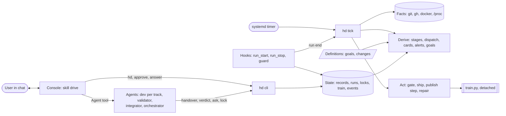
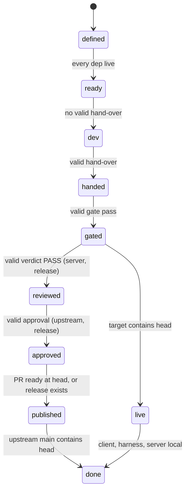

# Architecture of the harness (hd)

The solution to docs/PROBLEM.md that meets docs/PRD.md (R1–R6). Each module's docstring is its spec; this file is the map.

## 1. In one paragraph

A **definition** (a goal or a change) is a committed file. Everything else — a change's stage, whether an agent works on
it, what needs the user, a goal's progress — is **derived** on every read from facts (git, GitHub, docker, the process
table) and from **records**, each written by the one actor that owns it. `hd tick` is a short idempotent command, run by a
systemd user timer every minute and after every agent run: it observes, derives, and does the next unmet step of each
change. The **console** (Claude Code, the user in chat) spawns the agents the tick lists and records the user's yes and
answers; nothing else depends on it. The only long process is the train.

## 2. Components



| Module | Responsibility |
|---|---|
| `hd/cli.py`, `hd.py` | the 12 commands, each with a caller: console `hd`, `approve`, `answer`; agents `handover`, `verdict`, `ask`, `lock`, `measure`; tick and hooks `tick`; people `new`, `dod`, `cost` |
| `hd/store.py` | definitions, records, locks, events; the state lock (`flock`) |
| `hd/observe.py` | facts: refs, `gh` PR state and checks, containers, images, pids, a hook's console pid |
| `hd/derive.py` | pure functions: stage per change, alive runs, dispatch, cards, questions, alerts, goal progress |
| `hd/act.py` | one tick: repair, run gates, ship, publish step, start the train; emit |
| `hd/server.py` | the server track: train queue, publish steps, finding filing, upstream sync |
| `hd/brief.py` | the agent brief from the definition and the stage |
| `hooks/run_start.py`, `run_stop.py`, `guard.py` | R3–R5 (section 7) |
| `gates/<track>.py` | the script gate of each track (section 6) |
| `train/train.py`, `image.sh`, `deploy.sh`, `Dockerfile.integration` | the train (section 8) |
| `hd.yaml` | repos, branch prefixes, roles, the agent count |
| `.claude/agents/*`, `.claude/skills/*` | role files and skills; `drive` is the console loop |

Targets: code ≤ 1 800 lines, tests ≤ 1 000, `hd.yaml` ≤ 30.

## 3. Data

**Definitions** (committed, `harness/`):
```yaml
# goals/client-api.md
slug: client-api
track: client
target: 100                 # percent of RuneLite API interface methods working
measure: tools/api-probe.sh # client repo; prints the percentage and writes its per-method report to the evidence dir
---
## Goal    (what is counted; how a probe proves a method)

# changes/<slug>.md
slug: stile-approach
track: server               # client | server | harness
kind: change                # change | release (client) | local (server)
title: ...
priority: P1                # P0..P3; P0 is a review fix
deps: []                    # slugs that must be live first
goal: client-api            # optional: the goal it serves
branch: fix/stile-approach  # only when it differs from <prefix>/<slug>
pr: 406                     # server: written when the PR exists
finding: 2345678            # server: the maintainer comment this change answers
---
## Change / ## Definition of done
```
The harness stores no list of methods: the API interfaces are the list and the probe tool owns the per-method report. A
goal's progress is its last measurement, one number.

**Records** (`harness/state/`, git-ignored; one owner each):
```
records/<slug>/handover.json  {head, base, evidence, summary}              dev
records/<slug>/gate.json      {head, base, checks{name: ok|detail}}        tick (script gate)
records/<slug>/verdict.json   {head, base, verdict, findings[]}            validator agent
records/<slug>/approval.json  {head, kind: upstream|release}               user (hd approve)
records/<slug>/hold.json      {text, by}                                   agent (ask) · hooks · user (answer removes)
goals/<goal>.json             {value, base, evidence}                      orchestrator run (hd measure)
runs/<name>.json              {agent_id, role, change, head, console_pid, ended, exit, last, usage}   hooks
locks/{ghidra,device}.json    {holder}                                     holder
trains/<id>.json              {pid, heads, failed_step, detail}            train.py
live.json                     {integration, image, rollback, upstream_main}   deploy.sh
events.jsonl                  append-only, UTC                             everyone, through store.event
```
`head` is the change's commit; `base` is what it was checked against (upstream `main` for server, `master` or the
integration tree for client). Evidence lives in `evidence/<slug>/` (this repo, git-ignored).

## 4. Derivation

Nothing here is stored. A record is **valid** when its `head` equals the change's current head and its `base` equals the
current base; a moved head or base voids it (R3).


A client or harness change goes `gated` → `live` (merge); a server change has two targets that advance independently:
the test server (`gated` → queued → train → `live`) and upstream (`reviewed` → `approved` → `published` → `done`). `hd`
shows both.

**Dispatch** is a pure function: for each change with no hold and no alive run, the role needed is the dev when ready
and not handed; the validator when gated and a validator exists and no valid verdict; the integrator for a failed train;
the orchestrator for a goal whose measurement is invalid (its base moved) or below target with no open change serving it. Order: priority,
then those that unblock the most dependents, then age. Take while the agent count has a free slot. A change whose last
run ended without the record it needed carries a hold. Nothing is written; the console spawns from the list.

## 5. Tracks

The core knows no track. Each track is one row of `hd.yaml` plus its gate; only the server has code of its own.

| | Client | Server | Harness | Goal |
|---|---|---|---|---|
| Dev | `client-dev` | `server-dev` | `harness-dev` | `orchestrator` (measures, files definitions) |
| `head` | `origin/client/<slug>` | fork `dev/<slug>` | local `harness/<slug>` | — |
| Script gate | repack log (7 `telemetry:` lines), device evidence, network QA when networking changes | fork CI and Formatting on a scratch merge with upstream `main`, spec present, one change, off upstream `main`, PR text files, boot | the touched tests | `measure` command |
| Agent review | none (a release: `client-qa`) | `server-qa` | none | none |
| Ship | merge into `master`, push | queue for the train; publish after approval | merge into `main`, push | — |
| Live | `master` contains head | `live.json.integration` contains head | `main` contains head | — |

Branches: client `client/<slug>`; harness `harness/<slug>`; server public `content/<slug>` or `fix/<slug>`, private
`local/<slug>`; the dev's ref on the fork is always `dev/<slug>`, and the public branch moves only by an approved publish.

## 6. Checks

Every change meets two kinds of check, cheapest first, each valid only for its `head` and `base`.

1. **Script gate** (tick, no tokens): everything a machine can decide, from `gates/<track>.py`, run in order cheap to
   expensive (static, tests and CI, then boot and device). Result in `gate.json`; the first failure stops it, and the
   dev is dispatched with that line. A check already passed for the same `head` and `base` is not run again. Docs-only
   changes skip build and device checks.
2. **Agent review** (a validator agent, tokens): only what needs judgment — accuracy against the wiki and recordings, PR
   text, the in-game check — and only after the gate passed. It writes `verdict.json`.
3. **Smoke test**: before new work on a track, a basic end-to-end probe runs when its base moved since the last pass.
4. **Measurement**: the orchestrator runs the goal's `measure` command in the real app and records `hd measure <goal>
   <value> --evidence <report>`. It is valid for its `base`; when the base moves it is measured again, which also guards
   regressions. The orchestrator reads the report to choose the gaps.

## 7. Hooks and console

| Hook | Event | Does |
|---|---|---|
| `run_start.py` | `SubagentStart` | writes `runs/<name>.json` from the Agent tool's prompt (first line ``Harness change `<slug>` run `<name>` ``), `agent_id`, role and the console pid |
| `run_stop.py` | `SubagentStop` | blocks the stop when the change still needs the run's record (hand-over, verdict, resolution or a question); otherwise writes `ended`, `exit`, `last`, `usage` from the transcript and runs `hd tick` |
| `guard.py` | `PreToolUse: Bash` (every role and the console) | one table: writes to OpenRune denied to all; fork pushes only to the role's refs; deploy, image and docker writes on the live stack denied; `hd approve` only to the console; targets resolved by remote URL and ref; every denial an event |

The console loop (skill `drive`): `hd` → spawn each listed agent (`subagent_type` = role, brief as prompt) → show each card
and question in full → record `hd approve <slug> <head>`, `hd hold <slug> "<fix>"` or `hd answer`. The console runs no
upstream or release command and never enters a worktree. A new card or question is pushed once.

## 8. Train and publish

**Train** (`train.py`, started by the tick when the queue is non-empty and none is alive; one at a time, holding
`flock` on `integration`): `pin` every queued head, `rebuild` `integration` from upstream `main` (`git rerere` replays
recorded conflict resolutions), `gate` (the fork's `qa.sh`), `image` (`image.sh`: keys copied from the live image, hash
checked, boot container), `deploy` (`deploy.sh`: rollback tag, `compose up -d --no-deps`, wait for "Server ready in",
roll back if the container exits). Success writes `live.json`. A failure writes `failed_step` and `detail`; the integrator
resolves once (`hd handover <train-id>`) and the tick reruns from `pin`.

**Publish and release** are not processes. Each tick does the next unmet step at an approved head: push the public
branch, open the PR, CI green at head (otherwise nothing this tick, and the card shows the step), comment, mark ready;
for a release: tag, create the release with the gate's APK and notices. Each step first reads GitHub to see whether it is
already done. A finding on an open PR is filed as a P0 change on the same branch, keyed by its id; upstream `main`
moving fast-forwards the fork's `main`, drops merged branches and queues a train.

## 9. Healing

| Fault | Fact | Repair |
|---|---|---|
| console died | its pid is gone, the run has no end | end its runs `console-died`, free their locks |
| agent stopped without its record | run ended, no valid record | hold with its last message |
| tick died, or two ticks | `flock` on the state dir | the timer starts the next; the second exits |
| lock held by a dead run | the run is not alive | free it |
| train died | pid gone, no `live.json` update | rerun from `pin` |
| orphan container (`qa-*`, `hd-boot-*`), clone, worktree | no alive run or train owns it | remove |
| images beyond live and rollback | `live.json` names both | `docker rmi` the rest |
| Docker down, BlueStacks absent, `gh` unauthenticated, usage limit | `docker info`, process list, `gh auth status` | one alert in `hd`; no retry |

Every repair is one event. Nothing retries on a schedule.

## 10. Requirements to mechanisms

| Requirement | Mechanism |
|---|---|
| R1 Goals | goal definitions, `hd measure`, `derive` progress, the orchestrator role |
| R2 Flow | `derive` stages and dispatch, `act`, `gates/`, `server.py`, `train.py` |
| R3 Integrity | records bound to `head` and `base`, `hd handover/verdict` refusals, `run_stop`, script gate before agent review, a measurement carrying its evidence and base |
| R4 Authority | `guard.py`, `hd approve`, the approved-head rule in publish and release steps |
| R5 Recovery | the timer, `flock`, `act` repair, `derive` alerts, idempotent steps |
| R6 Visibility | `hd`, cards, `events.jsonl`, `hd cost` |

## 11. Run and test

```
systemctl --user enable --now hd-tick.timer     # every minute: python3 ~/osrs-harness/hd.py tick
python3 ~/osrs-harness/hd.py                    # the console's list
python3 ~/osrs-harness/hd.py tick --dry-run     # derive and print, change nothing
python3 -m unittest discover -s tests           # a test per requirement; a fake observer stands in for git, gh, docker, /proc
```
