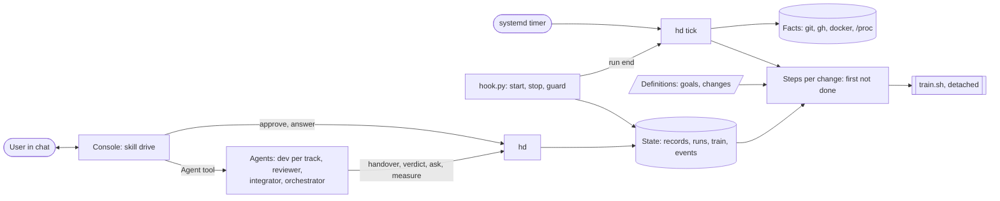
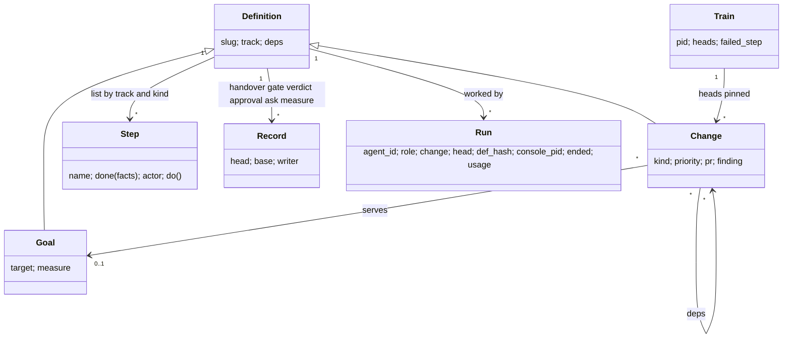
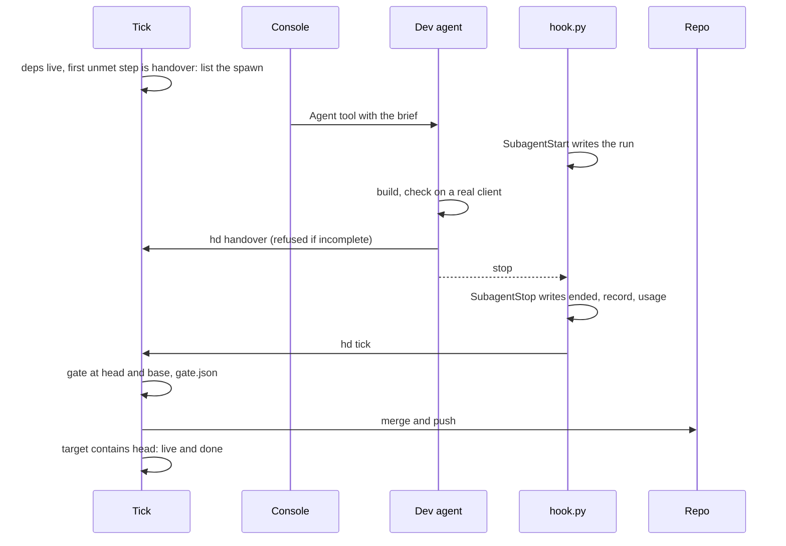
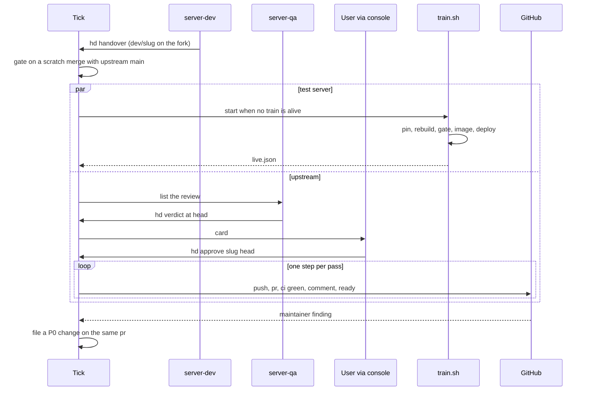

# Architecture of the harness (hd)

The solution to docs/PROBLEM.md that meets docs/PRD.md (R1–R7). Each module's docstring is its spec; this file is the map.

## 1. One mechanism

A **change is a list of steps**. A step is a predicate over facts ("done when") and an action by one of three actors: a
**script** (the pass runs it), an **agent** (the console spawns it), or the **user** (a card in chat). `hd tick` is one
short pass, run by a systemd user timer every minute and after every agent run: it reads the facts, and for every change
whose dependencies are live it does the first step that is not done. Stages, dispatch, cards, alerts and goal progress
are all read off the same step lists; nothing of the kind is stored. Repairs are steps of the harness itself, run first.



| Module | Responsibility |
|---|---|
| `hd.py`, `hd/cli.py` | nine commands: console `hd`, `approve`, `answer`; agents `handover`, `verdict`, `ask`, `measure`; people `new`; timer and hook `tick` |
| `hd/store.py` | definitions, records, events, the one `flock` on the state dir |
| `hd/facts.py` | refs and containment, `gh` PR state and checks, containers, images, pids with start time, the console pid of a hook |
| `hd/steps.py` | the step lists per track and kind, the repairs, dispatch; pure functions of facts and records |
| `hd/tick.py` | one pass: repairs, then the first unmet step of each ready change; emit |
| `gates/client.py`, `gates/server.py`, `gates/harness.py` | the script gate of each track |
| `hooks/hook.py` | one program, three events (section 6) |
| `train/train.sh` | the one long process (section 7) |
| `hd.yaml` | repos, roles with their refs, the agent count |
| `.claude/agents/*`, `.claude/skills/*` | role files and skills; `drive` is the console loop |

Targets: code ≤ 1 500 lines, tests ≤ 800, `hd.yaml` ≤ 25.

## 2. Data

**Definitions** (committed under `harness/`, written by people and the orchestrator):
```yaml
# goals/client-api.md
slug: client-api
track: client
target: 100                  # percent of RuneLite API interface methods working
measure: tools/api-probe.sh  # in the client repo; prints the number, writes its report to the evidence dir
---
## Goal

# changes/<slug>.md
slug: stile-approach
track: server                # client | server | harness
kind: change                 # change | release (client) | local (server: test server only)
priority: P1                 # P0..P3; P0 is a review fix
deps: []                     # slugs that must be live first
goal: client-api             # optional
pr: 406                      # server: the PR this change acts on, written when it exists
finding: 2345678             # server: the maintainer comment it answers
---
## Change / ## Definition of done / ## Answers
```

**Records** (`state/`, git-ignored; one writer each; a judgment carries the `head` and `base` it covers and is **valid**
only while both are current):
```
<slug>/handover.json   {head, base, evidence, summary}          dev            hd handover
<slug>/gate.json       {head, base, ok, detail}                 tick           gates/<track>.py
<slug>/verdict.json    {head, base, pass, findings[]}           reviewer       hd verdict
<slug>/approval.json   {head}                                   user           hd approve
<slug>/ask.json        {question, options[]}                    agent          hd ask; hd answer removes it
<goal>/measure.json    {value, base, evidence}                  orchestrator   hd measure
runs/<name>.json       {agent_id, role, change, head, def_hash, console_pid, console_start, ended, record, last, usage}   hook.py
train.json             {pid, start, heads, failed_step, detail} train.sh
live.json              {integration, image, rollback, upstream_main}           train.sh
events.jsonl           append-only, UTC                          everyone, through store.event
```
`head` is the change's commit (its dev ref); `base` is what it was checked against: upstream `main` for the server,
`master` for the client, `main` for the harness. Evidence is `evidence/<slug>/` in this repo, git-ignored. A pid is
stored with its start time, so a recycled pid is not alive.

## 3. Steps

The core knows three step kinds and reads the lists below; only the server list has code of its own (`gates/server.py`,
`train.sh`, the publish steps and finding filing in `steps.py`).

| Step | Done when | Actor and action |
|---|---|---|
| `handover` | a valid hand-over exists | **agent** `<track>-dev` on the dev ref |
| `gate` | a valid `gate.json` with `ok` | **script** `gates/<track>.py`, cheap checks first, first failure stops and is the dev's next brief |
| `merge` | the target contains `head` | **script**: merge, push |
| `queue` | `live.json.integration` contains `head` | **script**: start `train.sh` when none is alive |
| `review` | a valid verdict with `pass` | **agent** reviewer; a failing verdict is the dev's next brief |
| `approve` | `approval.json.head == head` | **user**: a card with the exact commands, full texts and the check records |
| `push`, `pr`, `ci`, `comment`, `ready` | the fact on GitHub at `head` | **script**, one per pass; `ci` not green is "nothing this pass" and the card says so |
| `merged` | upstream `main` contains `head` | none; a maintainer finding files a P0 change on the same `pr`, keyed by `finding` |
| `release` | the tag and release with the gate's APK exist | **script** |
| `measure` | `measure.json` valid for the track's live head and `value ≥ target`, or an open change serves the goal | **agent** orchestrator: runs the goal's command in the real app, records the number and its report, files changes with deps |

| List | Steps |
|---|---|
| client change, harness change | handover → gate → merge |
| client release | review → approve → release |
| server change | handover → gate, then two lists advance independently: `queue` (test server) and review → approve → push → pr → ci → comment → ready → merged (upstream) |
| server local | handover → gate → queue |
| goal | measure |

A change's **stage** is the name of its first unmet step; `hd` prints both lists for a server change. **Live** and
**done** are the containment facts of A6.

**Dispatch.** An agent step is listed for spawning when the change has no `ask.json`, no alive run, and the last run for it
ended with a different `head` or `def_hash` than now (otherwise the run's `last` message becomes a question for the user:
no agent loops on the same input). Order: priority, then age. Take while alive runs are fewer than the agent count. A
failed train lists the integrator the same way. The brief is the role file, the definition, the valid records and the one
line of what is owed.

## 4. Tracks

| | Client | Server | Harness |
|---|---|---|---|
| Dev ref | `origin/client/<slug>` | fork `dev/<slug>` | local `harness/<slug>` |
| Base | `master` | upstream `main` | `main` |
| Gate | repack log (telemetry lines), device evidence present, network QA when networking changed | fork CI and formatting on a scratch merge with upstream `main`, spec present, one change, PR texts present, boot | the touched tests |
| Reviewer | `client-qa` (release only) | `server-qa` | none |
| Ship | merge into `master` | `train.sh`; publish steps to `content/<slug>` or `fix/<slug>` after approval | merge into `main` |

The public branch of a server change moves only by an approved publish step; the dev writes `dev/<slug>` only.

## 5. Console

Skill `drive`: run `hd` → spawn each listed agent (`subagent_type` = role, brief as prompt) → show each card and question in
full → record `hd approve <slug> <head>` or `hd answer <slug> "<text>"` (the answer is appended to the definition's
`## Answers`, which changes `def_hash`, so the dev is dispatched again). The console runs no upstream or release command and
never enters a worktree. A new card or question is pushed to the user once.

## 6. Hooks

One program, `hooks/hook.py`, on three events, wired in `.claude/settings.json` and every role file.

| Event | Does |
|---|---|
| `SubagentStart` | writes `runs/<name>.json` from the prompt's first line (``Harness change `<slug>` run `<name>` ``), `agent_id`, role, `head`, `def_hash`, the console pid and its start time |
| `SubagentStop` | writes `ended`, `record` (whether the role's record now exists and is valid), `last` and `usage` from the transcript; binds the change from the transcript if the start could not; runs `hd tick` |
| `PreToolUse: Bash` (every role and the console) | **deny by default** for OpenRune: any `git` or `gh` command naming the upstream repo is denied unless it is a read verb; fork pushes only to the role's refs from `hd.yaml`; docker and deploy writes on the live stack denied; `hd approve` only from the console. Targets are resolved by remote URL and ref; every denial is an event |

## 7. Train

`train.sh`, started by the pass when a gated server head is not live and no train is alive (`flock` on the integration
clone; the kernel frees it on death), rerun from the start on failure: **pin** every gated head, **rebuild** `integration`
from upstream `main` (`git rerere` replays the integrator's recorded resolutions), **gate** (the fork's `qa.sh`), **image**
(keys copied from the live image, hash checked, boot container), **deploy** (rollback tag, `compose up -d --no-deps`, wait
for "Server ready in", roll back if the container exits), write `live.json`. A failure writes `failed_step` and `detail`;
the integrator resolves once (a recorded resolution or a dropped head) and hands over; the pass reruns.

## 8. Repairs

Steps of the harness itself, first in every pass; each repair is one event; nothing retries on a schedule.

| Fact | Repair |
|---|---|
| a run has no `ended` and its console pid (with start time) is gone | end it `console-died` |
| a run ended without its record | its `last` message is a question for the user (dispatch rule) |
| two passes | the second fails to take the `flock` and exits |
| `train.json` names a dead pid and `live.json` is older | rerun the train |
| a container, clone or worktree owned by no alive run or train | remove |
| images beyond `live.json`'s live and rollback | `docker rmi` |
| Docker down, BlueStacks absent, `gh` unauthenticated, usage limit | one alert in `hd`; no step runs that needs it |

## 9. Requirements to mechanisms

| Requirement | Mechanism |
|---|---|
| R1 Goals | goal definitions, the `measure` step, `hd measure`, the orchestrator role |
| R2 Flow | the step lists, `tick`, `gates/`, `train.sh`, the publish steps |
| R3 Integrity | records bound to `head` and `base`; `hd handover` and `hd verdict` refuse incomplete records; unknown facts stop the pass; `SubagentStop` records whether the record exists |
| R4 Authority | `hook.py` deny by default; `hd approve` console-only; publish and release steps run only at `approval.head` |
| R5 Recovery | the timer, `flock`, repairs, idempotent steps, pids with start times, rerun-from-pin |
| R6 Economy | gate before review before card; records keyed by `head` and `base`; the agent count; the no-loop dispatch rule |
| R7 Visibility | `hd`, cards, `events.jsonl`, usage from runs |

## 10. Run and test

```
systemctl --user enable --now hd-tick.timer     # every minute: python3 ~/osrs-harness/hd.py tick
python3 ~/osrs-harness/hd.py                    # the console's list
python3 ~/osrs-harness/hd.py tick --dry-run     # read facts, print the next step of every change, change nothing
python3 -m unittest discover -s tests           # one test per requirement; a fake facts module stands in for git, gh, docker, /proc
```

## 11. Model and sequences



**A client or harness change.**



**A server change: test server and upstream, independently.**



**A goal.**

```mermaid
sequenceDiagram
  participant T as Tick
  participant O as Orchestrator
  participant P as measure command
  participant S as Store
  T->>T: no open change serves the goal; measurement void or below target
  T->>O: list the spawn
  O->>P: run in the real app
  P-->>O: number and report
  O->>S: hd measure goal value --evidence report
  O->>S: hd new change ... with deps across tracks
```

**A dead console.**

```mermaid
sequenceDiagram
  participant Ti as Timer
  participant T as Tick
  participant F as Facts
  participant S as Store
  Ti->>T: every minute
  T->>F: console pid and start time of each run without an end
  F-->>T: gone
  T->>S: end the runs console-died; remove what they owned; one event each
  Note over T: the changes are listed again on the next pass
```
