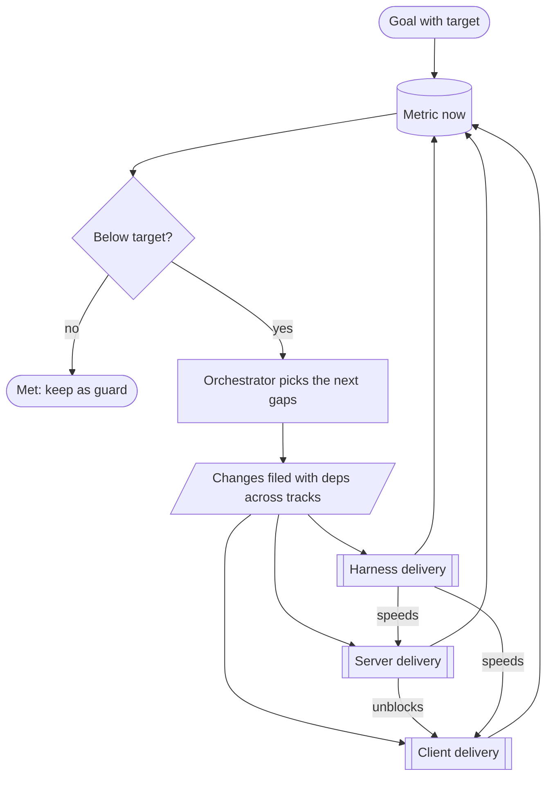
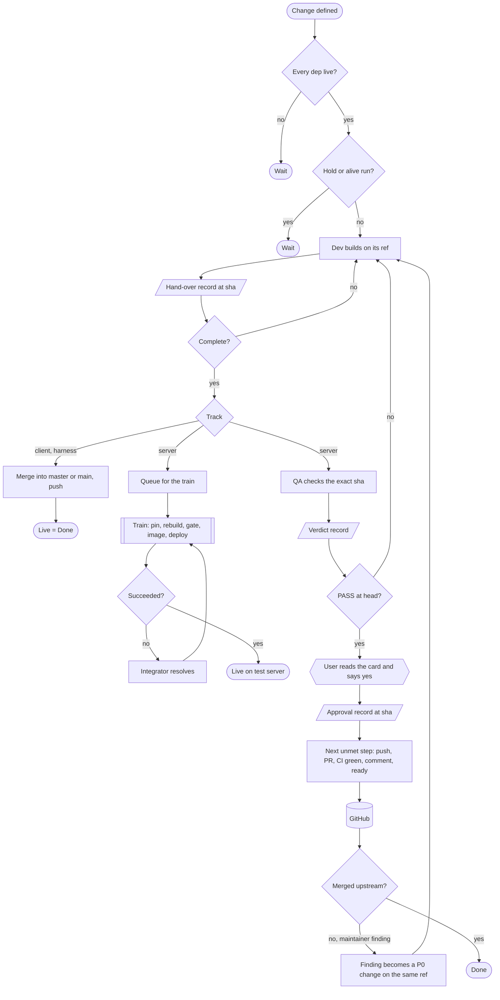

# Problem

The business context, the goals and the process. docs/PRD.md states what a solution must satisfy; docs/ARCHITECTURE.md is
the solution.

## Business context

The user wants **goals** reached with no person watching, overnight and across days. A goal is an outcome of one track
with a measurable fact; the client's goal is "100% of the RuneLite API working in the Android app". The three tracks are
**three deliveries** that depend on each other, so a goal of one track is served by changes of all three:

| Track | Delivers | Live when | Done when |
|---|---|---|---|
| Client | RuneLite plugins in the official OSRS Android app (AlexPerrin/osrs-plugins-reverse); a release is a tagged APK | `master` contains the commit | live |
| Server | server behaviour the client needs: the OpenRune fork (AlexPerrin/OpenRune-Server), contributed to OpenRune/OpenRune-Server | the test server's integration tree contains the commit | merged upstream (kind `local`: live) |
| Harness | the machinery that moves both and itself (this repo) | `main` contains the commit | live |

The tracks are interdependent. A client change that needs server behaviour waits for it; a server or client change that
the machinery slows down waits for a harness fix. The harness is neither product's code.

Priorities, in order: it runs unattended; it heals itself; it shows, from facts, what needs the user and what is running.
Only a write to the public upstream repository and a client release wait for the user, answered in chat.

The world:

- Claude Code agents do the work. The user's console session spawns them (Agent tool) and can watch. The console can
  vanish at any moment (usage limit, WSL restart, compaction, closed terminal) and its agents die with it; its absence
  pauses new spawns and nothing else.
- Agents are fallible. What git, GitHub, docker, the process table and a checked record show is the truth. Nothing is
  decided from elapsed time.
- Upstream is public and maintained by others who review in their own time and may report a defect at any point. They
  want one change per PR, no stacking, no tests unless needed. The fork, local commits and this repo are the user's own.
- The fork's CI on a scratch merge with current upstream `main` is the same fact as upstream's PR CI.
- Some things exist once: the integration clone, the live server, the Ghidra project, the Android device. Machine budget:
  agents, builds, desktop clients.
- Python 3.12 standard library and PyYAML only. WSL2 with systemd; Docker Desktop and BlueStacks run on Windows and are
  started by hand.
- No client contacts Jagex; the user's own RuneLite and the tester account are never touched.

## Goals

**A goal** belongs to one track, has a metric that a command prints as a number and a target, and stays open after the
target is met as a guard: the metric must not drop. Changes of the other tracks serve it as dependencies. The
orchestrator pursues every open goal (below).

**Client.** Plugins work in the official Android app. The client's goal is **100% of the RuneLite API** working in the
app; its metric is the share of the RuneLite API interface methods (the `Client` interface and the other API interfaces) that
a probe calls in the app and confirms working. Each change is built, checked on a real client and
merged into `master`; a release is cut after a network and privacy check, with the user's yes.

**Server.** (1) Unblock client work: the test server runs a change as soon as it is handed over and gated, whatever
upstream thinks. (2) Contribute: every change reaches OpenRune as a clean, single-purpose, verified contribution; review
findings are settled before new PRs open.

**Harness.** Each iteration is simpler and faster; a change is live on the next tick with no restart.

## Process

### The orchestrator

A high-level role whose one job is to close the gap between each open goal's measured state and its target. Each pass it
reads the metric, finds the gap (for example the API methods not yet working), and files the next **changes** with their
dependencies across tracks, ordered by what unblocks the most. It files within the machine budget and writes no code. It
runs as an agent like any other, so it keeps working while the user is away.

### A change

All tracks share one shape. A change is **defined** (slug, track, title, priority, deps, definition of done). It is
**ready** when its deps are live. A dev agent builds it on the change's ref and hands over one commit with evidence; an
incomplete hand-over is refused. The change is **live** and **done** per the table above. What an agent produces is a
commit on a ref or a record on disk; what it says in chat counts for nothing.

Symbols: rounded = start or end · rectangle = action · diamond = decision · parallelogram = record on disk (one owner) ·
hexagon = the user in chat · double-bar box = a delivery or detached process · cylinder = an external fact.

**Client.** A developer builds in the Android app and hands over a commit with the repack log and device evidence; the
harness merges it into `master`. A release is a change made when the user asks: a QA agent gates `master` at one commit
(install, hooks, network, privacy); the user says yes; the harness tags and publishes the APK. A client change that needs
server behaviour files the server change and waits for it.

**Server.** A developer builds on a branch off current upstream `main`, checked against official game behaviour, and
hands over a commit on the fork. Two things follow independently: the test server (combine, build, gate, image, deploy)
and the upstream path (an independent check of the exact commit, put on one card). One approval covers one unbroken
sequence run by the harness; if CI is not green it stops and the card says so. A reported defect is fixed on the same PR
before it leaves draft, never promised for later. Review fixes come before new PRs; work that unblocks the client comes
first; changes that stay on the test server never go upstream.

**Harness.** A developer works in a worktree with a test per requirement touched; the harness merges and pushes; a major
revision is merged only after the user's yes. Each iteration starts from the three source docs and ends by updating them;
whatever no requirement needs is removed.

## The user's day

The user opens the console and sees, from facts: each open goal's metric against its target, the agents to spawn, the
cards waiting for a yes (exact commands, full text to post, check record), the questions agents could not answer, the
alerts only they can fix (Docker engine down, BlueStacks absent), and what is running. Everything else was repaired by a
tick without them.
