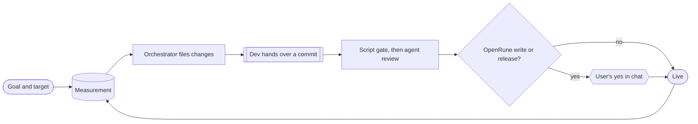

# Problem

The first principles the harness is derived from: the facts of the world we cannot change (axioms), what follows from
them (principles), and what the user wants (goals). docs/PRD.md turns the principles into constraints on any solution;
docs/ARCHITECTURE.md is the one solution we build.

## Axioms

| Id | Fact |
|---|---|
| A1 | The user wants outcomes in two products, reached with nobody watching, overnight and across days. |
| A2 | Claude Code agents do the work. Only a live console session can spawn them (Agent tool); it can vanish at any moment (usage limit, WSL restart, compaction, closed terminal) and its agents die with it. |
| A3 | Agents are fallible and their words are not evidence. Evidence is a commit on a ref, a file on disk, GitHub state, docker state, the process table. |
| A4 | Two actions are public or irreversible: a write to OpenRune/OpenRune-Server and a client release. The user alone authorizes them, in chat. Everything else is the user's own and reversible. |
| A5 | Upstream is maintained by others: one change per PR, no stacking, no tests unless asked, a defect reported at any time. The fork's CI on a scratch merge with current upstream `main` is the same fact as upstream's PR CI. |
| A6 | A change is live when its target contains it: client `master`, the tree the test server runs, harness `main`. A server change is done when upstream `main` contains it; every other change is done when live. |
| A7 | Some things exist once: the integration clone, the live server, the Ghidra project, the Android device. The machine bounds how many agents, builds and clients run at once. |
| A8 | Elapsed time says nothing about what happened. |
| A9 | Python 3.12 standard library and PyYAML; WSL2 with systemd; Docker Desktop and the Android emulator run on Windows and are started by hand; `gh` is authenticated as the user. |
| A10 | No client contacts Jagex; the user's own RuneLite and the tester account are never touched. |

## Principles

| Id | Principle | From |
|---|---|---|
| P1 | **Facts decide.** Every decision reads git, GitHub, docker, the process table, or a record bound to the commit it covers. An unknown fact (a failed fetch, an unreachable host) stops the step; it is never read as false. | A3 A8 |
| P2 | **Store only what cannot be derived.** Definitions (what the user wants), judgments (a hand-over, a verdict, an approval, a measurement, a question) and run starts and ends. Each judgment is bound to the commit and base it covers; when either moves it is void. Everything else is derived on each read. | A3 A2 |
| P3 | **Every step is idempotent.** A step is "done when this fact holds" plus "do this"; running it again is harmless. Any process may die anywhere and the next pass continues. | A2 A8 |
| P4 | **Nothing depends on a process.** A timer runs a short pass; a dead console pauses spawning and nothing else; the only long process rebuilds from pinned commits, so rerun equals resume. | A2 A1 |
| P5 | **One authority.** Only the harness writes to OpenRune or publishes a release, only at a commit the user approved, and agents are denied by default. | A4 |
| P6 | **Cheapest check first.** A script before an agent, an agent before the user; a check passed for a commit and base is not run again. | A1 A3 |
| P7 | **Scarce things are single-flight or counted.** A kernel lock for the one integration tree; one number for agents. Tools that own a resource (Ghidra, `buildq.sh`) keep their own lock. | A7 |
| P8 | **The user sees derived facts only:** what runs, what waits for them, each goal's progress, what happened. | A1 A3 |

## Goals

A **goal** belongs to one track and has a command that prints one number and a target. Changes of every track serve it;
a met goal stays measured as a guard.

| Track | Delivers | Goal |
|---|---|---|
| Client | RuneLite plugins in the official OSRS Android app (AlexPerrin/osrs-plugins-reverse); a release is a tagged APK | 100% of the RuneLite API interface methods working in the app, proven by a probe |
| Server | the behaviour the client needs, on the test server at once and contributed to OpenRune | the client is never blocked on the server; every contribution is single-purpose, verified and settled before the next opens |
| Harness | the machinery that moves both and itself (this repo) | each iteration is simpler and faster; a change is live on the next pass |

## Process

An **orchestrator** agent closes the gap between each goal's measurement and its target by filing **changes** with
dependencies across tracks. Every change has one shape: defined, built by a dev agent into one commit with evidence,
checked by scripts then by an agent where judgment is needed, and shipped. Only a write to OpenRune and a release wait
for the user's yes in chat. A server change reaches two targets independently: the test server as soon as it is gated,
upstream after the user's yes. A maintainer's finding files a new change on the same PR.

