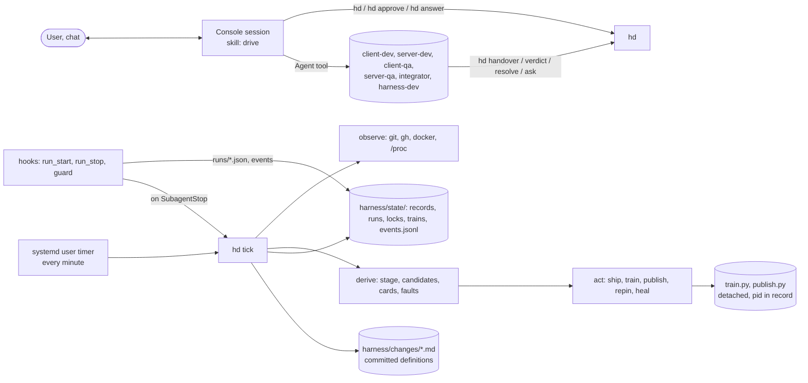

# Harness v7 — proposal

Three parts: the problem (context, evidence, goals, constraints, assumptions, each track's process), the requirements
(R-*, each testable), the architecture (the least complex solution found that meets them). Nothing in v6's docs, memory
rules or code was taken as given; every claim below was checked against the event log (3 054 events, Oct 21–25), the
daemon logs, 29 session transcripts (593 of the user's messages) and the code.

---

## Part 1 — PROBLEM

### 1.1 Context

Two products, one person, no one watching at night.

| Product | Repo | Live when | Published as |
|---|---|---|---|
| Client: RuneLite plugins inside the official OSRS Android app | AlexPerrin/osrs-plugins-reverse | `master` contains the commit | tagged APK release |
| Test server: fork of OpenRune, kept identical to the official game | AlexPerrin/OpenRune-Server (fork of OpenRune/OpenRune-Server) | the live container runs an integration tree containing the commit | pull request merged upstream |

The harness is a third track, this repo. Work is done by Claude Code agents. The user spawns them from a console session
(the Agent tool) and talks to that console in chat. The user's two priorities: it runs overnight and across days without
them; it heals itself. Only an action on the public upstream repository and a client release wait for the user, and the
answer comes in chat.

### 1.2 Evidence: why v1–v6 did not meet those two priorities

Six generations in twelve days. Each rebuilt the previous one's hot spot within hours and kept its structure.

| Observed in v1–v6 | Measure | Structural cause |
|---|---|---|
| The console had to be alive for anything to start, end, or release a lock | 89/165 runs never linked; `hd handover` did not clear `owner`, so with the console gone **no QA was ever booked**; booked-unspawned runs filled capacity after 3 | the console was the only mover; liveness was a record, not a process |
| Cost unknown | 153/165 runs ended with `tokens=0` | cost was a number the console had to type |
| Agents outlived their work | 76/165 ends were `stopped:lingering`; cd50/sd39/ig7 "running" 66 h; sq59 alive 71 min after its run ended | records said alive; nothing looked at the process |
| Dispatch loops | sd47…sd58: 12 devs in 16 min on one failing check | a failing check re-entered the change at `ready` |
| The daemon never ran a night | 63 start/stop lines in two operating days; a 62.7 h silent gap with no stop record; two tickers at once at the end | every code change was a restart; nothing supervised the process; nothing excluded a second ticker |
| Mechanism accretion | 7 172 lines for a job the audit sizes at ~2 300; 14 incident patches still in the code; "live" expressed five ways; 14 `hd` subcommands with no caller | each incident got a rule on top; none removed the dependency that caused it |
| State churn committed | 92 of 172 commits on `main` are "harness: record the change store" | mutable state lived in the committed change file |
| Rules re-given | fork-free/upstream-approval ×9, "explain before asking" ×4, "do not stack PRs" ×3, "what is fin/?" twice | the harness did not hold the rule, memory did |
| Disk and process residue | 66 GB agent clones, 45 GB QA clones, 7 image generations, a v3 page server alive 7 h after its command was deleted, a `deploy.sh` polling a deleted batch for a day | nothing owned the lifetime of what a run created |

### 1.3 Goals, in order

1. **Unattended.** A night and a weekend pass; every change that could move, moved; the user returns to approvals only.
2. **Heals.** Whatever a fault leaves behind (a dead console, a dead ticker, a dead agent, a stuck lock, an orphan
   container or clone, a drifted record) is repaired by the next tick with no one asked.
3. **Legible.** The console shows the user exactly what needs them and what is running, from facts, with no state of its
   own.

### 1.4 Constraints (hard, observed)

| | Constraint | Consequence for the design |
|---|---|---|
| C1 | Agents are spawned only from the console session with the Agent tool (the user wants to watch and poke at them there). The console can vanish at any moment: usage limit, WSL restart, compaction, closed terminal. Its subagents die with it. | The console's absence may pause **new spawns** and nothing else. A dead console must be an observable fact that ends its runs. |
| C2 | Agents are fallible. | Nothing an agent says is a fact; what git, GitHub, docker, the process table and the record it wrote through a checked command show is. |
| C3 | Only the user acts on OpenRune upstream or publishes a client release; the yes is given in chat. | An approval is a **recorded fact bound to a commit**; who executes the action after the yes must not need the console alive. |
| C4 | Things that exist once: the integration clone, the live server, the Ghidra project. A machine budget: builds, image builds, desktop clients (2), Android devices (2), agents. | Locks for the singletons, counted slots for the budget, both bound to a live process. |
| C5 | Python 3.12 stdlib and PyYAML. WSL2; Docker Desktop and BlueStacks live on Windows and are started by hand. | Some faults are the user's hands: they are listed, not healed. |
| C6 | Claude Code loads agent definitions, hooks and MCP servers at session start; hooks receive the subagent's id and transcript path; a subagent transcript carries per-message token usage (verified on disk). | Run start, run end and cost can be recorded by hooks, never by the model. |
| C7 | The fork's CI on a scratch merge with current upstream `main` is the same fact as upstream's PR CI. | Gate on the fork before anything is public. |
| C8 | GitHub turns every `- [ ]` in a PR body into a task; maintainers want one change per PR, no stacking, no tests unless needed. | PR text rules are a check, not advice. |

### 1.5 Assumptions

- A1 Every fact worth acting on is readable in seconds by a command (`git`, `gh`, `docker`, `/proc`).
- A2 A tick that re-derives everything from facts is idempotent: it may run at any time, any number of times, from any
  process; two at once must be excluded by a lock, not by hope.
- A3 Each actor writes exactly the one record it owns and nothing else: the dev its hand-over, QA its verdict, the user
  the approval and answers, the hooks run start/end/cost, the train its step results. The tick writes no record about a
  change; it only acts.
- A4 A definition (what a change is) and its state (where it is) have different owners and different lifetimes: the
  definition is committed and written by people and devs; the state is derived or recorded and never committed.

### 1.6 Each track's process, in plain language

**All tracks.** A change is defined (slug, track, title, priority, definition of done, optional deps). When its deps are
live it is ready. A dev agent builds it on the change's branch and hands over one commit with evidence; the hand-over is
refused unless complete. An independent check follows where the track needs one. The change is live when its target
contains the commit. It is done when live (client, harness, server-local) or merged upstream (server).

**Client.** Dev builds the plugin or hook in the Android app, hands over with the repack log and device evidence. The
harness merges into `master`. A release is a change of its own: a QA agent gates `master` at one commit (install,
hooks, network and privacy); the user says yes in chat; the harness tags and publishes the APK.

**Server.** Dev builds on a branch off current upstream `main`, against official behaviour, and hands over. Two things
follow independently: the integration train (pin, rebuild, gate, image, deploy — the test server runs it as soon as it
is checked) and the upstream path (QA aggregates every check of the exact commit onto one record; the user approves the
commit in chat; the harness pushes, waits for green CI, comments, marks ready; then waits for the maintainers; a
maintainer finding becomes a new change on the same PR). Server work that unblocks the client comes first; review fixes
come before new PRs.

**Harness.** Dev works in a worktree with a test per requirement touched and hands over; the harness merges into `main`
and the next tick runs the new code (no restart). A major revision is deployed only after the user's yes.

---

## Part 2 — REQUIREMENTS (PRD)

Each requirement is testable and traces to a goal (U unattended, H heals, L legible, P product rule). "Fact" means
something read from git, GitHub, docker, the process table or a record written through a checked `hd` command.

### Facts, not records of records
| Id | Requirement | Goal |
|---|---|---|
| R1 | No stage, status or liveness is stored. Each is derived on every read from facts; the only stored things are definitions, records written by their owner (R3), locks and the event log. | U H |
| R2 | No decision uses elapsed time. A step ends on its result or on the fact that the result cannot come (process exited, container exited, run ended). Subprocess timeouts exist only as backstops for hung tools and are never read as a verdict. | U |
| R3 | One owner per record: dev → hand-over; QA → verdict; user → approval, answer; hooks → run start, run end, usage; train → step results. A record is bound to the commit it is about; a moved head voids it. | U |
| R4 | A change's definition (`harness/changes/<slug>.md`: slug, track, title, priority, deps, definition of done, spec) is committed; nothing under `harness/state/` is committed; the harness commits nothing. | L |

### Runs
| Id | Requirement | Goal |
|---|---|---|
| R5 | A run exists from the hook that sees the subagent start to the hook that sees it stop. Start records the agent id, role, change, head and the console's pid; stop records exit, last message and token usage summed from the subagent transcript. The model never records either. | U L |
| R6 | A run is alive iff it has no end record and its console pid is alive. A dead console ends all its runs (`exit: console-died`), frees their locks and makes their changes dispatchable again. | H |
| R7 | A run cannot stop with its change at `dev`/`verify`/`exception` and no record on disk (the stop hook blocks). A run that stops anyway (max turns, error) puts a hold on the change carrying its last message; the change is not dispatched again until the hold is answered. The same change at the same head gets no second run of the same role while one is alive or the last one ended with no record. | U |
| R8 | Dispatch is a pure function of facts: candidates in priority then age order, minus changes with an alive run or a hold, up to the free slots of every class the role uses. Nothing is booked ahead; the list is recomputed on every call. | U |
| R9 | A role's brief is generated from the change and the stage; rules reach agents only through the role file and the brief. | U |

### Approvals and the user
| Id | Requirement | Goal |
|---|---|---|
| R10 | Exactly two kinds of action need the user: an action on an OpenRune PR (open, push to its head, comment, ready, draft) and a client release (tag, publish). Fork, local and harness actions need none. | P |
| R11 | An approval is `hd approve <slug> <sha>` recorded after the user's yes in chat; the tick performs the action as one resumable sequence of observed steps (push → CI green at sha → comment → ready), never the console. If CI does not go green it stops and the card says so. | U P |
| R12 | No approval is offered before the verdict passed at the same sha. The card shows the exact commands, the full text to be posted, every check line and finding, the diff range and caveats; the user's no or silence changes nothing. If GitHub already shows it done, the card is gone. | P L |
| R13 | A question an agent cannot answer is a hold with the question; `hd` lists it; the console asks in chat and records the answer with `hd answer`. The user is notified once per new card (PushNotification when Remote Control is connected). | L |

### Locks and capacity
| Id | Requirement | Goal |
|---|---|---|
| R14 | A lock exists for `integration`, `live-server`, `ghidra` only; it is bound to a run or a pid and is free the moment that holder is not alive. Tools that drive a locked resource refuse without the lock. | H |
| R15 | Capacity classes (`agent`, `build`, `image`, `client`, `device`) are counted from alive runs and alive trains only. | U |

### Server track
| Id | Requirement | Goal |
|---|---|---|
| R16 | A dev's output is the fork ref `dev/<slug>` (fork actions are free). The public branch (`content|fix/<slug>`, the PR head) moves only by an approved publish. `local/<slug>` ends at the test server. | P |
| R17 | A queued hand-over starts a train (one at a time): pin every handed-over head, rebuild `integration` in recorded order, gate, image (`COPY --from` the live image's keys, hash checked, boot checked), deploy with rollback. Steps are facts in the train record; the train is one process. A step failure books one integrator; its resolution resumes the train. | U H |
| R18 | QA's verdict covers, at the exact commit on a scratch merge with current upstream `main`: accuracy against the spec, fork CI and Formatting green, one change, upstream AGENTS.md/CONTRIBUTING/template, PR text (checkboxes verbatim, no deferral wording, no stacking), gameval ids, in game. A red check is a FAIL line, never a hold; the user decides on the card. | P |
| R19 | When upstream `main` moves, the fork's `main` fast-forwards, merged branches drop, a train runs. When upstream `main` contains a change's commit, the change is done. | U |
| R20 | A maintainer comment or review on an open PR newer than its ready time, by anyone but the fork owner or a bot, files one change (keyed by its id, P0, same branch) once. | P |

### Client and harness tracks
| Id | Requirement | Goal |
|---|---|---|
| R21 | Client hand-over needs the repack log (7 `telemetry:` lines), device evidence and, when networking changes, a network QA record; the harness merges into `master` and pushes. | P |
| R22 | A release is a change of kind `release` on `master` at one sha: its dev role is `client-qa` (the gate), its publish is approved by the user (R10), the harness tags and publishes the gate's APK. Autonomous versions are the next `0.1.x`. | P |
| R23 | A harness change is merged into `main` by the tick (`--no-ff`, pushed to origin); the next tick runs the new code. A major revision is merged only after the user's yes. | U |

### Healing and hygiene
| Id | Requirement | Goal |
|---|---|---|
| R24 | The tick is started by the OS on a schedule and by every run end; a dead tick is never restarted by hand; two ticks never run at once (a lock on the state dir). | H |
| R25 | Each tick: ends runs of dead consoles, reclaims locks of dead holders, removes containers, clones, worktrees and images owned by nothing alive (keeping the live and rollback images), books an integrator for a train whose process died without a final step, re-pins on upstream movement. Each repair is one event. | H |
| R26 | What only the user can fix (Docker engine down, BlueStacks absent, `gh` unauthenticated, usage limit hit) is an alert in `hd`, never a retry loop. | L |
| R27 | `events.jsonl` is append-only and records every record written, run start/end with usage, lock event, train step, repair and denial. `hd cost` reports tokens per change and role from run records. | L |

### Guards
| Id | Requirement | Goal |
|---|---|---|
| R28 | One guard hook, one table: agents and the console are denied every write to OpenRune and every deploy or docker write on the live stack; a push to the fork is allowed only to the role's refs (`dev/*`, `gate/*`, `docs`, tools); the tick's publish is allowed only with an approval record at that sha. Every denial is an event. | P |
| R29 | Only processes the harness started are stopped; the user's RuneLite and the tester account are never touched; no client contacts Jagex. | P |

### Acceptance
1. A night with no user message: changes dispatched, handed over, trained, deployed, merged; the user returns to cards only.
2. Fault injection, each repaired within one tick with no user action: console killed mid-run; tick killed mid-train; a lock whose pid is dead; an orphan `qa-*` container; a clone of an ended run; an approval given then the console killed before publish finished (publish completes).
3. A harness code change on `main` runs on the next tick without a restart.
4. Zero prompts to the user for anything but R10 actions and R13 questions.
5. Non-test code ≤ 2 500 lines; tests ≤ 1 500; policy ≤ 40 lines; no `hd` subcommand without a caller.

---

## Part 3 — ARCHITECTURE

### 3.1 Shape

One Python package `hd/` (~2 300 lines), one YAML config, three hooks, three shell/python train steps carried over from
v6 after review. No daemon process: `hd tick` is a short idempotent command run by a systemd user timer every minute,
by the run-stop hook, and by the console's `hd`. Long work (a train, a publish) is a detached subprocess the tick
starts once and then only observes.



| Module | Lines (budget) | Responsibility |
|---|---|---|
| `hd/cli.py` | 250 | the commands with callers: `hd` (list), `tick`, `new`, `dod`, `handover`, `verdict`, `approve`, `answer`, `hold`, `ask`, `resolve`, `lock`, `brief`, `cost`, `events` |
| `hd/defs.py` | 120 | definitions: parse/write `harness/changes/<slug>.md` |
| `hd/records.py` | 120 | `harness/state/records/<slug>/{handover,verdict,approval,hold}.json`, `runs/`, `locks/`, `trains/`, events |
| `hd/observe.py` | 250 | git refs (fork, client origin, this repo), `gh` PR/CI/comments, docker containers/images, pid alive, console pid |
| `hd/derive.py` | 250 | stage per change, dispatch candidates, capacity, cards, alerts — pure functions over facts |
| `hd/tick.py` | 200 | lock the state dir; observe; derive; act (ship, queue train, start publish, repin, heal); emit |
| `hd/heal.py` | 150 | the repairs of R25 |
| `hd/brief.py` | 100 | the agent brief from the definition and stage |
| `hd/tracks/{client,harness,server}.py` | 80 / 60 / 450 | the per-track facts and actions (3.4) |
| `hooks/run_start.py`, `run_stop.py`, `guard.py` | 60 / 90 / 150 | R5, R7, R28 |
| `train/train.py`, `image.sh`, `deploy.sh` | 350 total | one process per train, step results into the train record |
| `hd.yaml` | ≤ 40 | repos, prefixes, roles (classes used, worktree), capacity numbers |

### 3.2 Data

**Definition** (committed, owner: people and devs via `hd new`/`hd dod`):
```yaml
slug: stile-approach        # branch = <prefix>/<slug> unless `branch:` is set (a review fix shares its PR's branch)
track: server               # client | server | harness
kind: change                # change | release (client) ; local (server: test server only)
title: ...
priority: P1                # P0..P3, then age
deps: []                    # slugs that must be live first
pr: 406                     # server: set once the PR exists (observed, written by publish)
finding: 2345678            # server: the maintainer comment id this change answers
---
## Change            (the spec; for a server change the accuracy spec reference)
## Definition of done   (checkboxes; `hd dod <slug> <n>` ticks)
```
No `stage`, `hold`, `owner`, `commit`, `repo`, `cost`, `booked`, `live_commit`, `log` in the file. 142 v6 files are
migrated by stripping those keys; done ones are deleted (git history keeps them).

**Records** (`harness/state/`, git-ignored; owner in brackets):
```
records/<slug>/handover.json   {sha, evidence, summary, items, ts}            [dev, via hd handover's check]
records/<slug>/verdict.json    {sha, verdict, checks[], findings[], ts}       [QA, via hd verdict's check]
records/<slug>/approval.json   {sha, kind: upstream|release, ts}              [user, via hd approve after the yes]
records/<slug>/hold.json       {question|reason, by: run|user, ts} / answer   [agent via hd ask; user via hd answer; tick on R7]
runs/<slug>.<role>.<n>.json    {agent_id, role, change, head, console_pid, started, ended, exit, usage{...}, last}  [hooks]
locks/<resource>.json          {holder: run|pid, purpose, since}              [the holder, via hd lock]
trains/<id>.json               {pid, heads{slug: sha}, steps{pin|rebuild|gate|image|deploy: {ok, detail, ts}}, exception, resolution}  [train.py]
publish/<slug>.json            {pid, sha, steps{push|ci|comment|ready: ...}}  [publish.py]
events.jsonl                   append-only                                    [everyone]
```

**Derived, never stored** (3.3): stage, alive, candidates, cards, alerts, capacity used.

### 3.3 Derivation

Every read starts from facts. `head(slug)` is the track's ref: server fork `dev/<slug>` (or the PR head for a review
fix), client `origin/client/<slug>`, harness local `harness/<slug>`.

| Fact | Read from |
|---|---|
| head | `git ls-remote` / `git rev-parse` on the track's ref |
| handed / verified / approved at head | the record exists and its `sha == head` |
| live | track: client `master` contains sha; harness `main` contains sha; server `live.json`'s integration contains sha (written by deploy) |
| published / merged (server) | `gh pr view`: ready at head / `upstream/main` contains sha |
| run alive | run record without `ended` and `/proc/<console_pid>` alive |
| train alive | `/proc/<pid>` alive; a dead pid with no final step = exception |
| lock free | holder run not alive or pid dead |
| capacity used | alive runs' classes + alive trains' classes |

Stage is a label for display only; actions key on the facts:

```mermaid
stateDiagram-v2
  [*] --> defined: file exists
  defined --> ready: has DoD, every dep live
  ready --> dev: a dev run is alive  /  head exists with no hand-over at head
  dev --> handed: handover.sha == head
  handed --> verified: verdict.sha == head (server, release) ; = handed (client, harness)
  verified --> approved: approval.sha == head (server upstream, release)
  approved --> published: PR ready at head / release exists
  handed --> live: target contains head (ship: client, harness; train: server)
  published --> done: upstream main contains head (server)
  live --> done: client, harness, server local
  dev --> ready: head moved past the hand-over (records void)
```


A server change shows two columns, `test-server` (handed → live) and `upstream` (verified → approved → published → done),
because they advance independently.

**Dispatch** (`derive.candidates`): for each change without a hold and without an alive run, the role needed is
`dev` when ready and not handed at head; `verify` when handed and not verified at head and the track has a verify role;
`integrator` for a train at exception with no resolution. Sort by priority then `created`; take while every class the
role uses has a free slot. R7's twin rule: skip a change whose last run at this head and role ended without a record
(it has a hold anyway). Nothing is written.

### 3.4 Tracks

A track is one module with these functions (the only interface):

| Function | client | harness | server |
|---|---|---|---|
| `head(slug)` | `origin/client/<slug>` | local `harness/<slug>` | fork `dev/<slug>`, or the PR head for a review fix |
| `live(sha)` | `origin/master` contains | `main` contains | `live.json` integration contains |
| `done(sha)` | live | live | `upstream/main` contains (local: live) |
| `verify_role` | none (release: `client-qa`) | none | `server-qa` |
| `check(slug, sha, evidence)` | repack log, device evidence, netqa when networking | tests pass | spec present, one change, off upstream main, PR text files |
| `ship(slug, sha)` | merge into `master`, push | merge into `main`, push | queue for the train |
| `cards()` | release: gated and unapproved → tag card | — | verified and unapproved → contribute card; finding on a ready PR → draft card |
| `publish(slug, sha)` | tag at sha, release with the gate's APK | — | `publish.py`: push `dev/<slug>` → public branch (ff or merge, never force), open PR if none, wait CI green at sha, comment, ready |
| `step()` | — | — | file review-fix changes (R20); re-pin when `upstream/main` moved (R19); start a train when the queue is non-empty and no train is alive |

The server module is the largest (~450 lines) because it owns the PR conversation; the core knows nothing about PRs.

### 3.5 Runs, hooks, the console

```mermaid
sequenceDiagram
  participant T as hd tick (timer)
  participant C as Console (drive skill)
  participant H as hooks
  participant A as Agent (role)
  participant S as state
  T->>S: nothing to write; `hd` lists candidates with briefs
  C->>C: hd  (spawn list, cards, questions, alerts, alive runs)
  C->>A: Agent tool (subagent_type=role, prompt=brief, isolation=worktree per role)
  H->>S: SubagentStart: runs/<slug>.<role>.<n>.json {agent_id, console_pid, head}
  A->>S: hd handover|verdict|resolve|ask  (checked; refused if incomplete)
  A-->>H: SubagentStop: no record on disk? block. Else: ended, exit, usage from the transcript
  H->>T: hd tick
  T->>S: ship / queue train / start publish / heal
  C->>C: next loop: hd
```
- `run_start.py` binds the run to its change from the Agent tool's prompt (first line: `Harness change \`<slug>\` run
  \`<name>\``); `run_stop.py` binds from the subagent transcript's first user message and sums `message.usage`. Both
  are facts on disk; neither needs the model.
- The console loop (skill `drive`): `hd` → spawn each listed run → for each card, show it in full and ask (Approve /
  Fix first / No) → `hd approve` or `hd hold` or nothing → for each question, ask and `hd answer` → repeat, paced by
  `/loop`. Four verbs. No `run-link`, `run-end`, `run-stopped`, `contribute`, `resume`, `unhold`, `note`, `train`.
- If the console dies: its runs end on the next tick (`console-died`), locks free, the same changes reappear in the
  next console's spawn list with a brief that says a previous run died and names its branch.

### 3.6 Approval → publish

```mermaid
sequenceDiagram
  participant Q as server-qa
  participant T as hd tick
  participant C as Console
  participant U as User
  participant P as publish.py (detached)
  participant G as GitHub
  Q->>T: hd verdict <slug> PASS at sha (record checked against head)
  C->>U: the card: commands, PR title/body/comment, every check and finding, diff range, caveats
  U-->>C: yes
  C->>T: hd approve <slug> <sha>   (records; the console never touches GitHub)
  T->>P: start once (pid in publish/<slug>.json)
  P->>G: push dev/<slug> → <branch>; open PR if none; wait CI at sha; comment; ready
  P->>T: steps as facts; a red CI stops before the comment
  T->>C: card gone (PR ready at sha observed)
```
The guard allows an OpenRune write only to `publish.py` and only with `approval.sha == head`; agents and the console are
denied all of them. The same shape publishes a release (`tag`, `release create` with the gated APK).

### 3.7 Train

One process per train (`train/train.py <id>`), started by the tick when the queue has heads and no train is alive;
holds `integration` (and `live-server` during deploy) by its pid; writes each step's result into `trains/<id>.json`;
`image.sh` and `deploy.sh` are its steps (reviewed, poll-until-fact, rollback on container exit). The tick only observes:
pid dead with no `deploy.ok` and no `exception` → `exception` with the last step's detail → one integrator run →
`hd resolve <id>` → the tick starts the train again from `pin` (the resolution is recorded in `integration.txt`). No
step names in the core, no `queued/pinning/.../imaged` state machine, no `batches.lock`.

### 3.8 Healing (R25), one tick

| Fault | Fact | Repair |
|---|---|---|
| console died | `console_pid` dead, run has no end | end runs `console-died`; free locks; candidates recompute |
| agent ended without a record | run `ended`, no record at head, exit ≠ console-died | hold with `last` message (R7) |
| tick died mid-work | timer starts the next; state-dir lock held by a dead pid | take the lock |
| two ticks | `flock` on `harness/state/.lock` | the second exits |
| lock held by a dead holder | holder run not alive / pid dead | reclaim, event |
| train process died | pid dead, no final step | exception → integrator |
| live container exited after deploy | `deploy.sh` saw it | rollback (in the step), train exception |
| orphan `qa-*`, `hd-boot-*` container; clone under `openrune-work/agents/<run>`; worktree of a run | owner run not alive | remove, event |
| images beyond live and rollback | `live.json` names the two | `docker rmi` the rest |
| upstream `main` moved | `upstream/main` sha ≠ `live.json.upstream_main` | fast-forward fork main, queue a train |
| Docker engine down, BlueStacks absent, `gh` unauthenticated, usage limit | `docker info`, the BlueStacks process on Windows, `gh auth status`, the console's error | alert in `hd` (R26) |

### 3.9 Guards (R28)

One `guard.py` on `PreToolUse: Bash` for every role and the console, one write table: destination (OpenRune, fork ref
pattern, live docker stack, `hd` commands reserved to roles) × role → allow/deny. Pushes are resolved by remote URL and
ref, never by words. `publish.py` and `train.py` run outside Claude Code and are not hooked; the guard denies invoking
them from any agent or console Bash. `run_start.py` on `SubagentStart`, `run_stop.py` on `SubagentStop` (block when no
record; record end and usage). Three hooks, all in the committed `.claude/settings.json`; role files carry no hooks.

### 3.10 Requirements → mechanisms

| R | Mechanism |
|---|---|
| R1, R3, R4 | `derive.py` reads only `observe` + `records`; definitions in `defs.py`; `.gitignore` covers `harness/state/`; no write path commits |
| R2 | no `sleep`-until loops in `hd/`; `publish.py`/`train.py` poll for a fact and stop on the fact that it cannot come; subprocess timeouts raise, never decide |
| R5, R6, R7 | `run_start.py`, `run_stop.py`, `derive.alive`, `heal.console_died`, `derive.candidates` twin rule |
| R8, R9, R15 | `derive.candidates`, `brief.py`, `hd.yaml` roles/capacity |
| R10–R13 | `tracks.*.cards`, `hd approve`, `publish.py`, `guard.py`, `hd ask/answer`, PushNotification in the drive skill |
| R14 | `records.lock`, `train.py`/`deploy.sh` refuse without it, `heal.reclaim` |
| R16–R20 | `tracks/server.py`, `train/train.py`, `publish.py` |
| R21–R23 | `tracks/client.py`, `tracks/harness.py`, `kind: release` |
| R24, R25, R26 | systemd user timer `hd-tick.timer` (OnCalendar minutely) + `run_stop.py` calling `hd tick`; `flock`; `heal.py`; `derive.alerts` |
| R27 | `records.event`, `hd cost`, `hd events` |
| R28, R29 | `guard.py`; role files and skills (`test-instances`) |

### 3.11 What is deleted (the purge)

Code: all of v6 `hd/` (store, stages, tick, batches, ship, heal, agents, drive, actions, kpi, metrics, daemon, leases,
capacity, priority, maintain, check, policy, util, tracks/*), `hooks/{deny_publish,github_scope,publish_gate,
qa_write_scope,task_stop,slot_stop,shellparse,hdpaths,session_state.sh}`, 22 test files, `harness/retired/`,
`docs/evidence/`, `harness/policy.yaml` → `hd.yaml`. Kept after review: `train/image.sh`, `train/deploy.sh`,
`train/Dockerfile.integration`, the git helpers of `train/integrate.py` (folded into `train.py`), skills
(`server-track`, `client-track`, `accuracy-check`, `build-test`, `device-test`, `network-qa`, `pr-text-review`,
`server-probe`, `subtasks`, `test-instances`, `ab-test`) trimmed of harness mechanics, role files without hooks.

State: `harness/state/` is emptied and rebuilt from facts (nothing to migrate: stages are derived; the live server,
PRs and branches are the truth). `live.json` is kept.

Residue on the machine: pid 217615 (v3 page server), pid 791045 (`deploy.sh int-t-1` polling a deleted batch), the v6
`harness/handoff-v6` worktree and `worktree-agent-*` branch, `origin/progress-2026-10-24`; `~/src/openrune-work/agents`
(66 GB), `qa/` (45 GB), `dev-hunter`, `image-*` except the live one; docker volumes of ended agents (`*-dev-gradle`,
`*-gate-gradle`, `upstream-pr-gradle` 11 GB), 6 old image generations, build cache; client repo `re/harness/`,
`re-evidence/`, `re/ghidra-old`, six merged agent worktrees; `~/.claude/agent-dashboard` (7 GB, v3 monitor). The
containers `osrs-openrune-http(-desktop)` are recreated from `server-tools/docker-compose.yml` (their binds point at
deleted paths). Everything to keep is listed in the inventory; nothing live is touched.

Changes: 142 definition files → open ones stripped to the v7 schema (~60); `fin/*` and `acc/*` leftovers become one
decision each on the first `hd` list; done ones deleted.

### 3.12 Build and cutover (branch `v7`)

1. Hooks first, verified against a real Agent-tool spawn: run start binds to the change, run stop blocks without a
   record and records usage (acceptance 2 depends on it).
2. `defs`, `records`, `observe`, `derive`, `hd` list and `hd tick` with the client and harness tracks (small); the
   console loop; one unattended harness change end to end.
3. Server track: `dev/<slug>` convention, verdict, cards, `publish.py`, `train.py` wrapping the reviewed steps,
   review-fix filing, re-pin.
4. Heal and alerts; fault injection (acceptance 2); the purge; `docs/{PROBLEM,PRD,ARCHITECTURE}.md` rewritten from
   this proposal, `HANDOFF.md` and `ISSUES.md` reset.
5. Cutover (the user's yes): stop v6 (`hd stop`, kill the stale pids), `loginctl enable-linger` once, enable
   `hd-tick.timer`, start the console with the drive skill, merge `v7` → `main`.

---

## Open questions for the discussion

1. **Ticker.** A systemd user timer (needs `loginctl enable-linger alex` once, your sudo) makes the OS the supervisor and
   lets code changes take effect on the next tick with no restart. Alternative: the console's `/loop` runs `hd tick`
   (dies with the console) — I recommend the timer.
2. **Dev output ref on the fork.** `dev/<slug>` as the dev's ref, public branch moved only by an approved publish. This
   makes "push to a fork branch backing an open PR" impossible for agents by construction, at the cost of one more ref
   per change. Alternative: keep today's single branch and rely on the guard.
3. **Evidence location.** `~/osrs-harness/evidence/<slug>/` (git-ignored, harness-contained) instead of the client
   repo's `re/evidence/`. The client repo keeps only code and releases.
4. **Release creation.** On request only (`hd new --kind release`), with `hd` showing "N client changes live since
   v0.1.2" — or keep the automatic rule at N?
5. **Priority inheritance** across deps (v6 BR-C5) dropped in favour of priority then age, with review fixes filed at P0.
   Keep inheritance?
6. **Maintainer findings** auto-filed as definition files by the tick (a fact-derived definition you commit later), or
   proposed in `hd` for the console to file?
7. **Harness `main` pushed** by the tick after each merge (your repo, no approval), so origin never lags again?
