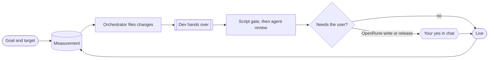

# Harness v7 — proposal

A summary of docs/PROBLEM.md, docs/PRD.md and docs/ARCHITECTURE.md on this branch, for review. It adds what they do not
carry: what v7 removes, the build order, the assumptions to verify and the decisions for you. It is deleted when v7 is
live.

## 1. Problem

You want goals reached with nobody watching. A goal belongs to one track and has a measurable fact; the client's goal is
**100% of the RuneLite API interface methods working in the Android app**. Three tracks deliver toward goals and depend
on each other:

| Track | Delivers | Live when | Done when |
|---|---|---|---|
| Client | plugins in the Android app, APK releases | `master` contains it | live |
| Server | behaviour the client needs, contributed to OpenRune | the test server runs it | merged upstream |
| Harness | the machinery that moves both | `main` contains it | live |

An **orchestrator** agent closes the gap between each goal's measurement and its target by filing changes, with
dependencies across tracks. Each change goes through the same flow: a dev hands over a commit, checks run, it ships.
Only a write to OpenRune and a client release wait for you.

## 2. Requirements (six, in outcomes)

| Id | Requirement |
|---|---|
| R1 Goals | progress is measured and work is chosen to close the gap |
| R2 Flow | a defined change reaches its live target with no person involved |
| R3 Integrity | what was checked and approved is exactly what ships; claims count only if verifiable |
| R4 Authority | only a write to OpenRune and a release need you |
| R5 Recovery | every failure is repaired without you; only what you alone can fix is raised, once |
| R6 Visibility | you can see what runs, what waits for you, each goal's progress, what happened |

The previous 32 requirements are gone; the checklists among them (QA, accuracy, hand-over contents, release gate,
hygiene) live in the role files and skills.

## 3. Architecture

One idea: a function over observed facts returns the next unmet step of each change; `hd tick` runs it every minute (a
systemd timer) and after every agent run. No daemon.

- **Stored:** committed definitions (goals, changes); records, each written by one owner and valid only for the commit
  and base it covers; locks for `ghidra` and `device`; the train; events.
- **Derived on every read:** stage, who works on what, dispatch, cards, alerts, goal progress.
- **Checks, cheapest first:** a script gate (no tokens) for everything a machine can decide, then an agent review only for
  judgment, then a smoke test only when the base moved. A check passed for the same commit and base is not re-run.
- **Goal:** a definition with a `measure` command and a target; the orchestrator runs it in the real app and records one
  number with its evidence. The harness keeps no per-method list.
- **Tracks:** one row of config each, differing in dev role, gate, review and ship step; only the server has code of its
  own (train, publish steps, findings).
- **Publish and release:** not processes; each tick does the next unmet step at an approved commit.
- **Healing:** a dead console, lock, train, container or clone is found as a fact and repaired in one tick.
- **Guard:** three hooks (`run_start`, `run_stop`, `guard`); nothing but the harness writes to OpenRune.

Size targets, unmeasured: code ≤ 1 800 lines, tests ≤ 1 000, `hd.yaml` ≤ 30, 12 commands, 7 modules.

## 4. What v7 removes from v6

| v6 | v7 |
|---|---|
| stored stage, hold, owner, booking, cost, log in the change file | derived on read, or a record with one owner |
| run link/end commands, lingering runs | two hooks write run start and end |
| the daemon, two tickers, restarts | one timer-run `hd tick` under `flock` |
| `hd contribute` with a sleep-poll; a publish process | tick steps that read GitHub first |
| train as a ten-step state machine, `queue.json`, `repin.json` | one script, rerun from the start; `git rerere` replays resolutions |
| five capacity classes, lease heartbeats | one agent count and two locks |
| 20-method track interface, three track modules | one config row per track, `server.py` only |
| six hooks, two shell parsers | three hooks |
| 32 requirements | six |
| 7 172 lines, 4 463 of tests, 68-line policy | targets above |

## 5. Build order (branch `v7`)

1. Hooks, verified live (built in `d1fa952`). Also verify: `SubagentStart` sees the prompt (fallback: bind at stop and
   count an unbound start alive for its console pid); `git rerere` replays across two clones.
2. `store`, `observe`, `derive`, `act`, `cli`, `brief`; the merge track; one harness change merged and pushed by the tick.
3. `server.py`, the train, publish steps, finding filing.
4. Goal: `hd measure`, the orchestrator role, the first client measurement.
5. Fault injection, purge of v6 (the list in the earlier proposal commit `488cc1c` stands), docs reset, this file deleted.
6. Cutover on your yes: stop v6, `loginctl enable-linger alex`, enable the timer, merge `v7` into `main`.

## 6. Assumptions I made, to confirm or overrule

1. The orchestrator files P1 to P3 changes freely within the agent count; P0 is reserved for review fixes.
2. A goal stays open as a guard after the target is met.
3. The client probe is `tools/api-probe.sh` in the client repo and prints the percentage; it may not exist yet.
4. A measurement holds the `device` lock for its whole run.
5. Publish lags up to a minute per step.
6. `git rerere` works for the integrator's resolutions.
7. The v7 hooks and `hd/records.py` already committed may cite the old R1 to R32 ids; not yet swept.

## 7. For your decision

1. Accept the six requirements and the architecture above?
2. Is the probe an existing tool, or the first thing to build for the client goal?
3. May I start build step 1 verification (rerere and the subagent start hook) now?
