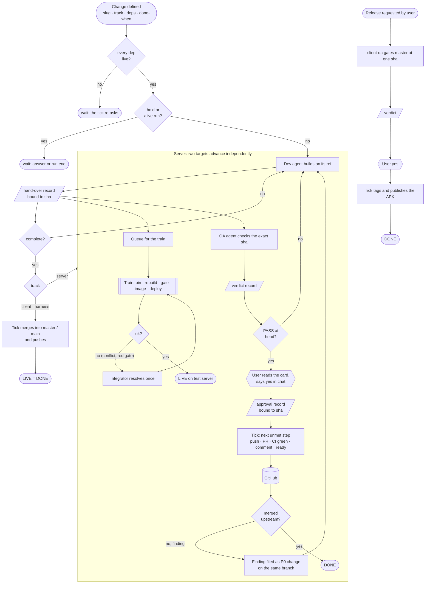
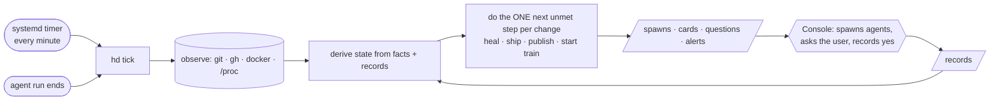

# Harness v7 — proposal (rewrite from first principles)

For review. If accepted, PROBLEM, PRD and ARCHITECTURE are rewritten to match (a PRD of 12 lines, not 89) and this file is
deleted. Nothing here changes the product goals: unattended, self-healing, legible, user only for upstream and releases.

## 1. Problem — the process

One shape for every track. Symbols: rounded = start/end · rectangle = action · diamond = decision · parallelogram =
record on disk (one owner) · hexagon = the user in chat · double-bar box = detached process · cylinder = a fact outside
the harness (git, GitHub, docker, `/proc`).

The loop around it, which is the only thing that runs:

## 2. PRD — first principles

Strip the 32 requirements to what a machine that moves changes must be true of. Everything else is a checklist for an
agent (a skill), not a requirement of the harness.

| # | Invariant | Replaces |
|---|---|---|
| 1 | **State is derived.** Stage, liveness and "what next" are computed from facts and records on every read. Nothing else is stored but definitions, records, locks, train, events. | R1, R15, R9 |
| 2 | **One owner per record, bound to a sha.** dev → hand-over, QA → verdict, user → approval and answers, hooks → runs. A moved head voids them. | R3, R8, R13 |
| 3 | **Progress is the next unmet step.** Every action is idempotent and checks its own result first; a re-run resumes. No decision reads the clock. | R2, R12, R27, R28 (resume) |
| 4 | **A run is alive iff its console is.** Hooks write start/end/usage; nothing the model says counts. A dead console frees everything it held. | R6, R7, R16 |
| 5 | **Only two actions need the user:** a write to OpenRune and a client release. Both run only at an approved sha, and only the harness's own publish step can do them. | R11, R12, R18, R31 |
| 6 | **Anything owned by nothing alive is removed** by the tick, one event each. What only the user can fix is an alert. | R28, R29 |
| 7 | **Scarce things are locked or counted:** one train at a time; Ghidra and the Android device by a lock; agents by one number. | R16, R17 |
| 8 | **Every write is an event; `hd` shows only facts.** | R15, R30 |

Moved out of the PRD into the skills and role files, where agents read them: the QA checklist (R20), accuracy source order
(R23), hand-over contents (R24), release gate details (R25), privacy and process hygiene (R32), review-fix filing (R22,
a tick rule in `server.py`, not a requirement).

Acceptance (unchanged in kind): a night of unattended merges and deploys; each fault in §3 healed within a tick; a
harness change live on the next tick; code ≤ 1 800 lines, tests ≤ 1 000, `hd.yaml` ≤ 30.

## 3. Architecture — where complexity goes

| Cut | From → to | Why it is safe |
|---|---|---|
| **No `publish.py` process, no publish record** | detached process with steps → the tick does the next unmet step | every publish step is a fact on GitHub (branch pushed? PR open? CI green? commented? ready?). Waiting for CI is "do nothing this tick". Same for release (tag exists? asset attached?) and ship |
| **Client and harness are one track** | two modules → one `merge` behaviour, two rows in `hd.yaml` (repo, branch, check) | both are "merge the handed-over sha into a branch and push" |
| **Only `server.py` is special** | 9 functions per track → `server.py` (train queue, publish steps, finding filing, upstream sync) | the core has no PR or CI knowledge |
| **Capacity classes → locks + one number** | 5 classes → `agents: N`; train is single-flight; `ghidra` and `device` are locks | builds already serialise in `buildq.sh`; clients are per-agent |
| **Train/`integration` locks by `flock`** | lock files with stale detection → the process holds `flock`; the kernel frees it on death | no reclaim code for the processes that matter |
| **Train has no step state machine** | per-step records, resume, `exception` stage → `trains/<id>.json {pid, heads, failed_step, detail}`; rerun from `pin` | rebuild from pins is deterministic, so rerun equals resume |
| **Conflict resolutions by `git rerere`** | recorded-resolution files and replay code → a shared rr-cache | git already replays a recorded resolution; the integrator resolves once. *Verify in step 1* |
| **Integrator is a dev of the train** | own record kind and `hd resolve` → `hd handover <train-id> <sha>` like any dev | one hand-over path |
| **Commands** | 15 → 11: `hd`, `tick`, `new`, `dod`, `approve`, `answer`, `handover`, `verdict`, `ask`, `lock`, `cost` | `events` is `tail`, `show` is `cat`, `resolve` is `handover` |
| **Modules** | 14 → 7: `cli`, `store` (defs, records, locks, events), `observe`, `derive`, `act` (tick, heal, ship, publish steps), `server`, `brief` | no behaviour removed, only seams |
| **Hooks** | unchanged: `run_start`, `run_stop`, `guard` (+ `shellparse`) — already built and committed | their weight is real enforcement, not ceremony |

Kept because removing it breaks a goal: definitions committed apart from state; hand-over/verdict/approval/hold records
bound to sha; the three hooks; the console loop with four verbs (`hd`, `approve`, `hold`, `answer`); the systemd timer;
the train as one detached process; `dev/<slug>` as the only ref a dev writes.

## 4. Decisions carried over (user, 2026-10-25)

Agent tool, never OS subprocesses · definitions committed, state never · systemd timer, no daemon · `dev/<slug>` private
ref, public branch moved only by an approved publish · evidence in this repo, git-ignored · releases on request ·
priority then age, review fixes at P0 · maintainer findings filed by the tick, one change per finding · the tick pushes
`main` after each merge.

## 5. Build order (branch `v7`)

1. Hooks verified live (built: `d1fa952`). Add: `git rerere` replay works across two clones; `SubagentStart` sees the
   prompt (fallback: bind at stop and count an unbound start alive for its console pid).
2. `store`, `observe`, `derive`, `act`, `cli`, `brief`; the merge track; one harness change merged and pushed by the tick.
3. `server.py`, `train.py` (wrapping reviewed `image.sh` / `deploy.sh`), publish steps, review-fix filing.
4. Fault injection, purge (list as in the previous proposal, unchanged), docs rewritten, this file deleted.
5. Cutover on your yes: stop v6, `loginctl enable-linger alex`, enable the timer, merge `v7` → `main`.

## 6. For your decision

1. Accept the PRD cut to 8 invariants, with checklists moved to skills?
2. Accept dropping `publish.py` for next-step-per-tick (publish may lag up to a minute per step)?
3. Accept `git rerere` for integrator resolutions (falls back to recorded patches if step 1 disproves it)?
